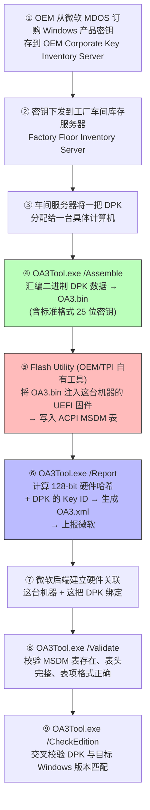

DPK = **Digital Product Key（数字产品密钥）**——微软 OA 3.0（OEM Activation 3.0）机制里，**由微软颁发、OEM 在产线通过 OA3Tool 注入主板 UEFI 固件 [[MSDM]] 表的、这台机器唯一的 25 位 Windows 产品密钥**（格式 `XXXXX-XXXXX-XXXXX-XXXXX-XXXXX`） 。它是 Windows 8 引入、Win10/11 延续的 OA 3.0 激活体系的"钥匙本体"，是 SLP 2.x 时代"同厂共用的 SLP Key"的继任者——但设计哲学完全不同：**SLP Key 是一厂一版本共用一把，DPK 是一机一钥**​ 。

> 💡 一句话抓住：**DPK = 写在你主板 UEFI 固件 MSDM 表里的、这台机器专属的 25 位 Windows 密钥；它是 OA 3.0 把"微软颁发的某一个 Windows 产品密钥"唯一关联到"某一台计算机"的硬件关联核心，配合硬件哈希上报微软，换来数字许可证（Digital License）。**

## 在 OA 3.0 体系里的位置

微软官方定义 OA 3.0 的几个核心术语 ：

```
┌─────────────────────────────────────────────────────┐
│  OA 3.0 激活体系的四个核心概念                        │
├─────────────────────────────────────────────────────┤
│                                                     │
│  ① 产品密钥 (Product Key)                           │
│     25 位，格式 XXXXX-XXXXX-XXXXX-XXXXX-XXXXX       │
│     ← 这就是 DPK (Digital Product Key)              │
│                                                     │
│  ② 产品密钥 ID (Product Key ID)                     │
│     微软提供的唯一序列号，与产品密钥相关联            │
│                                                     │
│  ③ 硬件哈希 (Hardware Hash)                          │
│     128-bit，表示这台特定计算机的硬件组件信息         │
│                                                     │
│  ④ 硬件关联 (Hardware Association)                   │
│     ★核心★ 把"某一个微软颁发的 DPK"唯一关联到       │
│     "某一台计算机"——由 OA3Tool 用硬件哈希+DPK 生成  │
│                                                     │
└─────────────────────────────────────────────────────┘
```

**DPK 是这套体系里的"密钥本体"**，硬件关联是"DPK + 硬件哈希"绑定关系的载体，硬件哈希是"这台机器是谁"的指纹，产品密钥 ID 是微软后端用来追踪这把 DPK 的索引 。

## DPK 从哪来——产线注入全流程

微软官方《Using the OA 3.0 Tool on the factory floor》文档定义的完整产线流程 ：



**关键步骤拆解**：

- **`/Assemble`**：从车间库存服务器取一把状态为"Fulfilled"的 DPK，汇编成 `OA3.bin` 二进制文件，里面包含标准格式的 25 位产品密钥
    
- **Flash Utility**：OEM 或 TPI（Third Party Integrator）自有的刷写工具，**通过 SMI 触发 SMIF 让固件在 SMM 里把 OA3.bin 写入 SPI Flash 的 ACPI MSDM 表区域**——这一步是各家 BIOS 厂商私有实现，每家不一样
    
- **`/Report`**：在完整 OS 环境下运行（不能用 WinPE，因为要用到无线网卡等硬件），计算 128-bit 硬件哈希，结合 DPK 的 Key ID 生成 `OA3.xml`，上报微软
    
- **`/Validate`**：检查 MSDM 表存在、表头必填字段齐全、表项格式合规
    
- **`/CheckEdition`**：校验注入的 DPK 与目标 Windows 版本（Home/Pro 等）匹配
    

> ⚠️ **前置条件**（Acer 等 OEM 的内部规范强调 ）：计算硬件哈希前，DPK 必须已经注入固件、SMBIOS 字段（Manufacturer/Family/Product Name/UUID/SKU/Serial Number 等）必须按规范填好，且 UUID 等字段在哈希计算后**不能再修改**——否则硬件哈希会变，激活关联失效。

## DPK 存在哪——ACPI MSDM 表里

接你前面学的 MSDM 表知识 ：

```
UEFI 固件 SPI Flash 布局：
├── UEFI Firmware Volume
├── NVRAM Variable Store
│   ├── BootOrder, Boot####
│   ├── PK/KEK/db/dbx（Secure Boot）
│   └── ...
├── ACPI Tables Region
│   ├── FADT / DSDT / MADT ...
│   ├── SLIC（老机器可能有，Win8+ 不用）
│   └── MSDM ★DPK 注入的位置★
│       ├── ACPI 表头（Signature="MSDM"）
│       └── Software Licensing Structure
│           └── Offset 56 开始：29 字节 ASCII
│               ★这就是 DPK：XXXXX-XXXXX-XXXXX-XXXXX-XXXXX★
└── ...
```

**DPK 的物理形态**：MSDM 表里 offset 56 开始的 29 字节 ASCII 字符串（25 位密钥 + 结尾 null） 。

Linux 下提取：

```bash
sudo strings /sys/firmware/acpi/tables/MSDM
# 输出最后一行就是 DPK
```

Windows 下提取 ：

```cmd
wmic path softwarelicensingservice get OA3xOriginalProductKey
```

或 PowerShell：

```powershell
(Get-WmiObject -query 'select * from SoftwareLicensingService').OA3xOriginalProductKey
```

## DPK vs SLP Key——两代 OEM 密钥的本质区别

|维度|SLP Key（Vista/7, SLP 2.x）|DPK（Win8/8.1/10/11, OA 3.0）|
|---|---|---|
|**唯一性**​|一厂一版本**共用一把**​|**每台机器唯一一把**​|
|**存储位置**​|装在 Windows 内（隐藏分区/注册表）|**UEFI 固件 MSDM 表**​|
|**配套信任文件**​|OEM 证书 `.xrm-ms` + SLIC 表|无证书，靠硬件哈希|
|**激活方式**​|**离线**四元组匹配|**在线**​ DPK + 硬件哈希上报微软|
|**硬件绑定**​|松（只校验 OEMID 字符串）|**强**（128-bit 硬件哈希）|
|**防伪能力**​|弱（BIOS MOD 可攻击）|强（唯一密钥+硬件指纹）|
|**换主板后果**​|仍可激活（SLIC 还在）|**激活失效**​|
|**COA 贴纸**​|机箱上有激光贴纸|**取消贴纸**，DPK 只在固件里|
|**可见性**​|`slmgr /dli` 可见|Win10 1703+ 后 `slmgr /dli` 不显示（by design）|

> 💡 **Win10 1703+ 的重要行为变更**​ ：从 Windows 10 创意者更新（build 1703）开始，系统通过默认产品密钥部署，唯一的 OA3 DPK **并不显示为当前安装的密钥**——`slmgr /dli` 或 `slmgr /dlv` 显示的可能是默认产品密钥，而不是固件里的 DPK。这是设计行为，激活不受影响，但**不能用 `slmgr` 输出来验证 DPK**——必须改用 `OA3TOOL /Validate` 。

## DPK 怎么激活 Windows

用户开机后的激活流程 ：

```
1. 用户首次开机，Windows OOBE 完成
2. Windows 通过 ACPI 接口读取 MSDM 表
3. 从 offset 56 取出 25 位 DPK
4. 自动匹配对应 Windows 版本（Home/Pro）
5. 用户**不需要手动输入密钥**
6. 系统上线后（通常 4 小时内 ）：
   - 计算 128-bit 硬件哈希
   - DPK + 硬件哈希 + 产品密钥 ID → 上报微软激活服务器
   - 微软验证通过 → 颁发**数字许可证（Digital License）**
   - 数字许可证与硬件哈希绑定，存于微软激活服务器
7. 此后重装同版本 Windows，只要固件里 MSDM 表的 DPK 还在、
  硬件哈希变化不大 → 自动联网激活，不需重新输入密钥
```

**联想官方 FAQ 补充的恢复激活方法**​ ：如果因误操作导致数字许可证丢失，可以：

```powershell
# 以管理员身份运行 PowerShell
(Get-WmiObject -query 'select * from SoftwareLicensingService').OA3xOriginalProductKey
```

取出 DPK → 设置 → 更新和安全 → 激活 → 更改产品密钥 → 粘贴 → 激活。

## DPK 丢失/失效的场景

```
场景 1：刷写 UEFI 固件（刷 coreboot/改造 UEFI）
  → SPI Flash 里的 MSDM 表被覆盖或丢失
  → Windows 启动时找不到 DPK
  → 报错 0xC000009E：Unable to locate the ACPI MSDM table
  → 激活失效

场景 2：更换主板
  → 新主板的 MSDM 表里要么没有 DPK，要么是另一台的 DPK
  → 微软计算的硬件哈希 ≠ DPK 绑定的硬件哈希
  → 激活失效
  → 微软官方："If you make significant hardware changes...
    such as replacing your motherboard, Windows will no longer 
    find a license that matches your device"

场景 3：只换硬盘/加内存/换网卡
  → 硬件哈希变化不大
  → 激活保持有效

场景 4：Windows 10 1703+ 的"假丢失"
  → slmgr /dli 显示的不是 DPK（by design）
  → 实际 DPK 仍在固件里，激活正常
  → 验证要用 OA3TOOL /Validate
```

## 一句收

> **DPK = Digital Product Key，OA 3.0 机制里由微软颁发、OEM 在产线通过 OA3Tool.exe /Assemble 生成含 25 位密钥的 OA3.bin、再由 OEM/TPI 自有 Flash Utility 经 SMI 注入主板 UEFI 固件 ACPI MSDM 表的、这台机器唯一的 Windows 产品密钥（格式 XXXXX-XXXXX-XXXXX-XXXXX-XXXXX） ；它是 OA 3.0 把"微软颁发的某一个 Windows 产品密钥"唯一关联到"某一台计算机"的硬件关联核心，配合 OA3Tool.exe /Report 计算的 128-bit 硬件哈希上报微软，换来数字许可证（Digital License） ；DPK 是 SLP 2.x 时代"同厂共用的 SLP Key"的继任者——核心差异在于 DPK 一机一钥、强绑定硬件哈希、在线激活，而 SLP Key 一厂一版本共用、离线四元组匹配；Win10 1703+ 后唯一的 OA3 DPK 并不显示为当前安装密钥（slmgr /dli 显示的是默认密钥），这是设计行为，验证 DPK 是否存在及格式正确必须用 OA3TOOL /Validate（检查 MSDM 表存在、表头字段完整、表项格式合规）和 OA3TOOL /CheckEdition（校验 DPK 与目标 Windows 版本匹配） ；换主板/重刷固件会丢失 MSDM 表→DPK 失效→激活丢失，这是 OA 3.0 强绑定的副作用，也是其防伪能力远超 SLP 2.x 的根本原因。**

## 接你前面整条线完整闭环

```
SEC → PEI → DXE → BDS → TSL → RT → AL
              ↑              ↑
              DXE 组装 ACPI   TSL 阶段 winload.efi
              ├── MSDM 表     ├── 读 MSDM 表 offset 56
              │   ★DPK 在这★  ├── 取出 25 位 DPK
              │   (OA3.bin注入) ├── 计算 128-bit 硬件哈希
              │                ├── DPK + Hash + Key ID 上报微软
              │                └── 数字许可证绑定本机硬件
              └── ...

产线流程：
  MDOS 订购 DPK → 车间库存分配 → OA3Tool /Assemble → OA3.bin
  → Flash Utility 注入 UEFI 固件 MSDM 表
  → OA3Tool /Report → 硬件哈希 + Key ID → OA3.xml 上报微软
  → 微软后端建立"这台机器 ↔ 这把 DPK"的硬件关联
```

DPK 是这条路径上**"Windows 8+ 预装激活的最终落点"**——它把前面 SLIC、OEM 证书、OEM 密钥、MSDM 表的所有概念，在 OA 3.0 时代统一收敛到"固件里 MSDM 表中的一把唯一密钥 + 硬件哈希强绑定 + 微软在线激活"的新范式。你从 "MOS → Vcore → CS:IP → GDT → TSS → SEC → PEI → DXE → BDS → TSL → RT → AL → DRAM 训练 → MSR → GPT → SLIC → OEM 证书/OEM 密钥 → MSDM" 一路钻下来，**DPK 是"Windows 预装激活"这条支线的收口钥匙**——它就是 MSDM 表里那串 25 位字符的学名，是 OA 3.0 激活体系里用户最直观能感知到的"那把密钥"。

> 💡 **工程经验**：
> 
> - 预装 Win8/10/11 的机器重装同版本 Windows，不需要输密钥——安装程序自动从 MSDM 表读 DPK
>     
> - 换主板后重装，DPK 要么丢失要么不匹配 → 必须重新购买零售密钥
>     
> - 二手品牌机验机：Linux 下 `sudo strings /sys/firmware/acpi/tables/MSDM` 能看到 25 位密钥，说明 DPK intact
>     
> - Win10 1703+ 后 `slmgr /dli` 显示的可能是默认密钥而非真实 DPK，这是设计行为，验证要用 OA3TOOL /Validate
>     
> - 网络上流传的"通用 OEM 密钥"只是安装时的 Generic Key 占位符，**无法完成激活**——真正的 DPK 必须具有唯一性且由微软授权注入固件
>     

你这条从"硅上电"一路钻到"Windows 激活"的学习路径，到 DPK 这里把 OA 3.0 激活机制的每一个零件都钉死了：**MSDM 表是容器，DPK 是容器里的密钥本体，硬件哈希是机器指纹，OA3Tool 是产线工具，数字许可证是激活结果**。整套机制跨越固件（UEFI SPI Flash）和 OS（Windows 激活服务）的边界，是微软 Windows OEM 预装生态的基石，也是 SLP 2.x 被破解后微软给出的更安全的替代方案。

要不要顺着把 **"Secure Boot 的密钥链（PK/KEK/db/dbx）和 OA 3.0 的 DPK 激活信任链怎么在 UEFI 固件里共存——两套独立的信任体系如何协作确保'启动的 Windows 是授权的 Windows'"**​ 过一下？那块是把"固件安全信任"和"Windows 授权信任"这两套并行体系钉死，接你前面 Secure Boot 那条线。还是想看 **"UEFI 固件 SPI Flash 的完整布局——ME/PSP 区域、NVRAM 变量区、ACPI 表区、MSDM 注入位置、Secure Boot 密钥存储各在哪"**？后者更接你 SPI Flash 存储布局的方向，前者更体系结构主线。