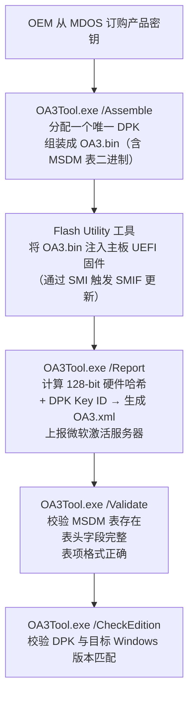

MSDM = **Microsoft Data Management Table（微软数据管理表）**——ACPI 规范里的一张可选表，**Windows 8 引入的 OA 3.0（OEM Activation 3.0）激活机制的硬件落点**。OEM 厂商在主板 UEFI 固件的 ACPI 表集合里写入这张表，里面装着**这台机器唯一的 25 位 Windows 产品密钥（DPK, Digital Product Key）**​ 。它是 SLP 2.x 时代 SLIC 表的继任者——但设计哲学完全不同：SLIC 是"厂商级证书+通用密钥"的离线信任，MSDM 是"单机唯一密钥+硬件哈希"的在线信任。

> 💡 一句话抓住：**MSDM 表 = UEFI 固件里给 Windows 8/10/11 预装激活用的"密钥保险柜"——每台机器一张，表里存着这台机器唯一的 25 位产品密钥；Windows 安装/启动时读这张表，拿到密钥+算硬件哈希上报微软，在线激活并绑定本机。**

## 在 ACPI 表家族里的位置

接你前面学的 DXE 阶段组装 ACPI 表：

```
ACPI 表集合（DXE 阶段由固件组装）：
├── RSDP（根指针）
├── RSDT/XSDT（目录）
├── FADT / DSDT / MADT / HPET / MCFG ...
├── SLIC（Vista/7 的 SLP 2.x 激活表，Win8+ 机器可能仍有但不用）
├── MSDM ★你问的这张★（Win8+ 的 OA 3.0 激活表）
└── ...
```

congatec 的 BIOS 应用笔记明确说："**The OA 3.0 ACPI_MSDM table contains the key that is proprietary to and exclusively for the Windows OEM Activation 3.0 solution. The table must be added to the systems BIOS as a standard ACPI System Description Table**" ——也就是说，MSDM 是一张标准的 ACPI 系统描述表，由 OEM 通过微软 OA3Tool 生成、flash 工具注入固件 。

## MSDM 表的二进制结构

微软官方文档给出的 MSDM 表格式 ：

| Byte Offset | Byte Length | Field                             | 说明                                                 |
| ----------- | ----------- | --------------------------------- | -------------------------------------------------- |
| 0           | 4           | **Signature**​                    | 固定为 `"MSDM"`                                       |
| 4           | 4           | Length                            | 整表长度（字节）                                           |
| 8           | 1           | Revision                          | 0x01                                               |
| 9           | 1           | Checksum                          | 整表校验和                                              |
| 10          | 6           | **OEMID**​                        | 厂商标识（如 `"LENOVO"`），必须与 RSDT/XSDT 里的 OEMID 一致       |
| 16          | 8           | **OEM Table ID**​                 | 表标识（如 `"TP-N20 "` ）                                |
| 24          | 4           | OEM Revision                      | 表修订版本                                              |
| 28          | 4           | Creator ID                        | 创建工具标识（如 `"PTEC"`）                                 |
| 32          | 4           | Creator Revision                  | 创建工具版本                                             |
| 36          | 可变          | **Software Licensing Structure**​ | ★核心载荷★ 从 offset 36 开始，由微软工具生成的专有结构，包含 25 位 [[DPK]] |

**Software Licensing Structure 的内部布局**（从 offset 36 开始）：

```
Offset 36: Version (4 bytes)
Offset 40: Reserved (4 bytes)
Offset 44: Data Type (4 bytes)  // 通常为 1 = Product Key
Offset 48: Data Reserved (4 bytes)
Offset 52: Data Length (4 bytes) // 通常为 0x1D = 29
Offset 56: Data (29 bytes)      // 25 位产品密钥的 ASCII 字符串
                                   格式：XXXXX-XXXXX-XXXXX-XXXXX-XXXXX
```

Linux 下实际 dump 一台联想机器的 MSDM 表 ：

```
$ sudo strings /sys/firmware/acpi/tables/MSDM
MSDMU
LENOVOTP-N20 
PTEC
XXXXX-YYYYY-ZZZZZ-DDDDD-TTTTT
```

- `MSDMU` → Signature "MSDM" + 长度/版本等头信息
    
- `LENOVOTP-N20` → OEMID="LENOVO" + OEM Table ID="TP-N20"
    
- `PTEC` → Creator ID（创建工具）
    
- 最后一行 → **这台机器唯一的 25 位产品密钥**
    

## MSDM 在 OA 3.0 工厂流程中的注入

微软官方文档描述的产线流程 ：



**关键点**：

- `OA3.bin` 是 MSDM 表的二进制载体，由微软 OA3Tool 生成
    
- Flash Utility 是 OEM/IBV 自有工具，通过 SMI 触发固件更新将 OA3.bin 写入 SPI Flash
    
- 注入后 MSDM 表就成为 UEFI 固件 ACPI 表集合的一部分
    
- 微软错误码 `0xC000009E` = "Unable to locate the ACPI MSDM table in the firmware"——MSDM 表缺失的直接报错
    
- 错误码 `0xC000009C` = "The ACPI MSDM table found... contains invalid or corrupted data"——MSDM 表数据损坏
    

## Windows 启动/安装时怎么用 MSDM

### 全新安装场景

Windows 8/10/11 安装介质启动时：

1. Windows Setup 早期阶段通过 ACPI 接口读取 MSDM 表
    
2. 从 offset 56 取出 25 位 DPK
    
3. 自动匹配对应 Windows 版本（Home/Pro 等）
    
4. 用户**不需要手动输入密钥**
    
5. 安装完成后，系统上线时自动用 DPK + 硬件哈希向微软激活服务器请求激活
    
6. 激活成功 → 颁发**数字许可证（Digital License）**绑定本机硬件
    

### 已激活系统场景（Win10 创意者更新 1703+ 的重要变化）

微软官方说明 ：

> ⚠️ **从 Windows 10 创意者更新（build 1703）开始，`OA3 DPK` 并不总是显示为设备中当前安装的密钥**。`slmgr /dli` 或 `slmgr /dlv` 显示的可能是默认产品密钥，而不是固件里的 OA3 DPK。这是**设计行为（by design）**，激活状态和用户体验不受影响。

所以**不能再用**​ `slmgr /dli` 来验证 OA3 DPK——微软建议改用 `OA3TOOL /Validate` ：

- 确保 MSDM 表存在
    
- 确保 MSDM 表头包含所有必要字段
    
- 确保 MSDM 表项存在且格式正确
    
- `OA3TOOL /CheckEdition` 交叉校验 DPK 与目标 Windows 版本匹配
    

## 在不同系统下读取 MSDM 表

### Linux 下读取

```bash
# 方法 1：直接 cat（会看到二进制乱码+密钥字符串）
$ sudo cat /sys/firmware/acpi/tables/MSDM | tail -1

# 方法 2：用 strings 过滤出可读字符串
$ sudo strings /sys/firmware/acpi/tables/MSDM
MSDMU
LENOVOTP-N20 
PTEC
XXXXX-YYYYY-ZZZZZ-DDDDD-TTTTT

# 方法 3：用 acpidump 工具
$ sudo acpidump -n MSDM
MSDM @ 0x0000000000000000
0000: 4D 53 44 4D 55 00 00 00 03 B1 4C 45 4E 4F 56 4F  MSDMU.....LENOVO
0010: 54 50 2D 4E 31 31 20 20 40 11 00 00 50 54 45 43  TP-N11  @...PTEC
0020: 02 00 00 00 01 00 00 00 00 00 00 00 01 00 00 00  ................
0030: 00 00 00 00 1D 00 00 00 46 43 4B 47 57 2D 52 48  ........FCKGW-RH
0040: 51 51 32 2D 59 58 52 4B 54 2D 38 54 47 36 57 2D  QQ2-YXRKT-8TG6W-
0050: 32 42 37 51 38                      2B7Q8

# 方法 4：精确提取密钥（offset 56 开始，29 字节）
$ sudo hexdump -s 56 -e '"MSDM key: " /29 "%s\n"' /sys/firmware/acpi/tables/MSDM
MSDM key: XXXXX-XXXXX-XXXXX-XXXXX-XXXXX
```

### Windows 下读取

```cmd
# 方法 1：WMIC（传统）
> wmic path SoftwareLicensingService get OA3xOriginalProductKey
OA3xOriginalProductKey
XXXXX-XXXXX-XXXXX-XXXXX-XXXXX

# 方法 2：PowerShell（现代）
PS> Get-CimInstance -ClassName SoftwareLicensingService | Select-Object OA3xOriginalProductKey

# 方法 3：Windows API（开发者）
# 调用 EnumSystemFirmwareTables 定位 'MSDM'
# 调用 GetSystemFirmwareTable 获取 MSDM 表原始二进制
# 从 offset 56 提取产品密钥字符串
```

> ⚠️ 如果上面命令返回**空白**，不代表机器没激活——可能原因 ：
> 
> - Windows 10 1703+ 创意者更新后，OA3 DPK 不显示为当前密钥（by design）
>     
> - 系统是零售密钥（Retail Key）激活 → 密钥存在 Microsoft 账户里
>     
> - 系统是数字许可证（Digital License）激活 → 绑定硬件哈希，本地无可用密钥
>     
> - 系统是批量授权（Volume/KMS/MAK）激活
>     

## MSDM vs SLIC 的本质区别

接你前面学的 SLIC 知识：

|维度|SLIC 表（Vista/7, SLP 2.x）|MSDM 表（Win8+, OA 3.0）|
|---|---|---|
|**引入版本**​|Windows Vista|Windows 8|
|**密钥类型**​|同厂同版本**共用**一个 SLP Key|每台机器**唯一**​ DPK|
|**激活方式**​|**离线**四元组匹配|**在线**​ DPK + 硬件哈希上报|
|**表的核心内容**​|OEM 公钥 + SLP Marker 签名|25 位产品密钥（明文 ASCII）|
|**配套信任文件**​|OEM 证书 `.xrm-ms`|**无证书概念**​|
|**硬件绑定**​|松（只校验 OEMID 字符串）|**强**（128-bit 硬件哈希）|
|**防伪能力**​|弱（BIOS MOD 可攻击）|强（唯一密钥+硬件指纹）|
|**换主板后果**​|仍可激活|**激活失效**​|
|**表结构相似度**​|表头结构几乎一样|表头结构几乎一样|
|**本质差异**​|厂商身份证|单机密钥保险柜|

两者**表头结构几乎一样**（都是 ACPI 表的标准头），差异在 payload ：

- SLIC 的 payload 是 RSA 签名过的 SLP Marker + OEM 公钥
    
- MSDM 的 payload 是从 offset 56 开始的 29 字节 ASCII 字符串（25 位密钥 + 结尾 null）
    

## MSDM 在 UEFI 固件里的存储

```
SPI Flash 布局：
├── UEFI Firmware Volume（固件代码）
├── NVRAM Variable Store
│   ├── BootOrder, Boot####
│   ├── PK/KEK/db/dbx（Secure Boot）
│   └── ...
├── ACPI Tables Region
│   ├── FADT / DSDT / MADT ...（编译进固件）
│   ├── SLIC（老机器可能有）
│   └── MSDM ★OA3.bin 注入的位置★
│       └── 由 Flash Utility 通过 SMI 写入
└── ...
```

**关键事实**​ ：

- MSDM 表是**标准 ACPI 表**，必须出现在 ACPI XSDT/RSDT 的目录里
    
- 工厂产线通过 Flash Utility 将 OA3.bin 注入固件——这个工具是 OEM/IBV 私有的，每家不一样
    
- 注入通常通过 **SMI（System Management Interrupt）**​ 触发 SMIF（SMI Function）让固件在 SMM 里更新
    
- 主板出厂后，MSDM 表**只读**——OS 只能通过 ACPI 接口读取，不能修改
    

## 刷固件/换主板为什么会掉激活

这是 OA 3.0 + MSDM 机制下最常见的问题：

```
场景 1：重刷 UEFI 固件（如刷 coreboot/改造 UEFI）
  → SPI Flash 里的 MSDM 表被覆盖或丢失
  → Windows 启动时找不到 ACPI MSDM 表
  → 报错 0xC000009E：Unable to locate the ACPI MSDM table
  → 激活失效

场景 2：更换主板
  → 新主板要么没有 MSDM 表，要么是另一台的 DPK
  → Windows 计算的硬件哈希 ≠ DPK 绑定的硬件哈希
  → 激活失效
  → 微软官方说法："If you make significant hardware changes... 
    such as replacing your motherboard, Windows will no longer 
    find a license that matches your device"
  → 必须重新购买密钥或联系 OEM/微软客服

场景 3：只换硬盘/加内存/换网卡
  → 硬件哈希变化不大
  → 激活保持有效
```

## 一句收

> **MSDM = Microsoft Data Management Table，ACPI 规范里的一张标准系统描述表，Windows 8 引入的 OA 3.0 激活机制的硬件落点；表头结构与其他 ACPI 表一致（Signature="MSDM"、Length、Revision、Checksum、OEMID、OEM Table ID、OEM Revision、Creator ID、Creator Revision），从 offset 36 开始的 Software Licensing Structure 是微软 OA3Tool 生成的专有结构，其中 offset 56 开始是 29 字节 ASCII 字符串——即这台机器唯一的 25 位 Windows 产品密钥（DPK） ；OEM 产线通过 OA3Tool.exe /Assemble 生成 OA3.bin，再通过自有 Flash Utility 经 SMI 注入主板 UEFI 固件的 ACPI 表区域 ；Windows 安装/启动时通过 ACPI 接口读 MSDM 表，取 DPK + 计算 128-bit 硬件哈希上报微软激活服务器，在线激活并绑定本机硬件，激活信息以数字许可证形式存在微软账户/激活服务器 ；MSDM 表缺失报 0xC000009E 错，数据损坏报 0xC000009C 错 ；Linux 下可通过 `sudo strings /sys/firmware/acpi/tables/MSDM` 读取，Windows 下可通过 `wmic path SoftwareLicensingService get OA3xOriginalProductKey` 读取（但 Win10 1703+ 后 DPK 可能不显示，需用 OA3TOOL /Validate 校验）；它是 SLP 2.x 时代 SLIC 表的继任者，核心差异在于 MSDM 存"单机唯一密钥"+ 强硬件绑定，而 SLIC 存"厂商级证书"+ 离线四元组匹配。**

## 接你前面整条线完整闭环

```
SEC → PEI → DXE → BDS → TSL → RT → AL
              ↑              ↑
              DXE 组装 ACPI   TSL 阶段 winload.efi
              ├── FADT/DSDT/   ├── 读 ACPI MSDM 表
              │   MADT/...     ├── 从 offset 56 取 25 位 DPK
              ├── SLIC        ├── 计算 128-bit 硬件哈希
              │   (Vista/7)    ├── DPK + Hash 上报微软激活服务器
              ├── MSDM ★      └── 匹配成功 → 数字许可证
              │   (Win8+)         → Windows 激活
              └── ...
              
工厂产线：
  OA3Tool /Assemble → OA3.bin（含 MSDM 表）
  Flash Utility → 注入 UEFI 固件 SPI Flash
  OA3Tool /Report → 上报 DPK Key ID + 硬件哈希到微软
```

MSDM 是这条路径上**"Windows 8+ 预装激活的固件信任锚"**——它和前面学的 SLIC、OEM 证书、OEM 密钥一起，构成了微软 Windows OEM 预装商业模式的完整技术基础。从 Vista/7 的 SLIC + .xrm-ms 证书 + SLP Key 三位一体离线激活，到 Win8+ 的 MSDM + DPK + 硬件哈希 + 在线激活，微软把"激活"从"厂商级信任"细化到"单机级信任"，根除了 SLP 2.x 时代"BIOS MOD 软激活"的漏洞。

> 💡 **工程经验**：
> 
> - 预装 Win10/11 的机器重装同版本 Windows，**不需要**输密钥——安装程序会自动从 MSDM 表读 DPK
>     
> - 换主板后重装，MSDM 表要么丢失要么不匹配 → 必须重新购买零售密钥
>     
> - 二手品牌机验机：Linux 下 `sudo strings /sys/firmware/acpi/tables/MSDM` 能看到厂商+密钥就说明 OA 3.0 激活 intact
>     
> - 刷第三方固件（coreboot 等）会丢 MSDM → 预装 Windows 掉激活
>     
> - Win10 1703+ 后 `slmgr /dli` 显示的可能是默认密钥而非真实 DPK，这是设计行为
>     

你从 "MOS → Vcore → CS:IP → GDT → TSS → SEC → PEI → DXE → BDS → TSL → RT → AL → DRAM 训练 → MSR → GPT → SLIC → OEM 证书/OEM 密钥" 一路钻下来，**MSDM 是这条"Windows 预装激活"支线的收口**——它把前面 SLIC、OEM 证书、OEM 密钥的所有概念，在 Windows 8+ 时代统一收敛到"固件里一张 MSDM 表 + 每台机器唯一密钥 + 硬件哈希在线绑定"的新范式。整套机制跨越了固件（UEFI SPI Flash）和 OS（Windows 激活服务）的边界，是微软 Windows OEM 预装生态的基石。

要不要顺着把 **"Secure Boot 的密钥链（PK/KEK/db/dbx）和 OA 3.0 的 MSDM 激活信任链怎么在 UEFI 固件里共存——两套独立的信任体系如何协作确保'启动的 Windows 是授权的 Windows'"**​ 过一下？那块是把"固件安全信任"和"Windows 授权信任"这两套并行体系钉死，接你前面 Secure Boot 那条线。还是想看 **"UEFI 固件 SPI Flash 的完整布局——ME/PSP 区域、NVRAM 变量区、ACPI 表区、MSDM 注入位置、Secure Boot 密钥存储各在哪"**？后者更接你 SPI Flash 存储布局的方向，前者更体系结构主线。