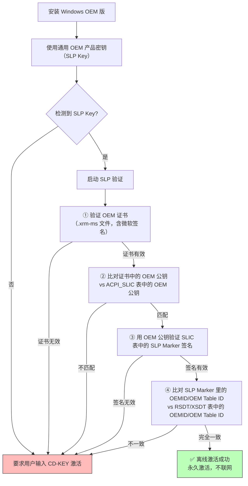

SLIC = **Software Licensing Internal Code / Description Table（软件许可内部码/描述表）**——OEM 厂商在主板固件（BIOS/UEFI）的 **ACPI 表集合**里写入的一段特殊数据，用作 Windows OEM 版**离线激活的信任锚**。它不是 UEFI 启动流程的必需组件（没有它机器照样能开机进系统），但**没有它，预装 Windows 就无法"开箱即激活"**。

> 💡 一句话抓住：**SLIC 是微软 SLP（System-Locked Preinstallation）2.0+ 激活机制的硬件落点——OEM 工厂在主板的 ACPI 表里烧一段带微软数字签名的"厂商身份证"，Windows 安装时比对这张身份证 + OEM 证书 + OEM 密钥，三者全对上就离线激活，不需要联网、不需要输序列号。**

## 在 ACPI 表家族里的位置

你前面学的 [[DXE]]阶段会建 ACPI 表，SLIC 就是其中一张可选的 OEM 授权表：

```
ACPI 表集合（DXE 阶段由固件组装，通过 XSDT/RSDT 暴露给 OS）：
├── RSDP（根指针）
├── RSDT/XSDT（指向所有其他表的目录）
├── FADT（固定 ACPI 描述表）
├── DSDT（差异化系统描述表——AML 代码）
├── MADT（多核中断）
├── HPET（高精度定时器）
├── MCFG（PCIe ECAM）
├── ...
├── SLIC ★你问的这张★
└── MSDM（Windows 8+ 的 OA3.0 激活表）
```

微软官方文档原话："**ACPI-compatible BIOS uses the ACPI_SLIC table to store software licensing description information**" 。

## SLIC 表的结构

SLIC 表长度固定 **1024 字节**，Signature 字段就是 ASCII 的 `"SLIC"`：

```
Offset  Size  Field
0x00    4     Signature = "SLIC"（ASCII）
0x04    4     Length = 1024
0x08    1     Revision
0x09    1     Checksum（所有字节 mod 256）
0x0A    6     OEM ID（如 "LENOVO"）
0x10    8     OEM Table ID（如 "TP-R0"）
0x18    4     OEM Revision
0x1C    4     Creator ID = "MSFT"
0x20    4     Creator Revision
0x24    972   Binary Data（编码后的许可 blob + RSA 签名）
```

**最后那 972 字节才是灵魂**——里面包含一个由微软私钥签署的 **RSA 签名 + SLP Marker**，Marker 里又嵌着 OEM 公钥和 OEMID/OEM Table ID 字符串 。

## SLIC 激活的完整校验链（Windows Vista/7）

微软 SLP 2.0/2.1 的激活逻辑是一个**四元组匹配**​ ：



**四个必须同时成立的要件**：

1. **OEM 证书**（`.xrm-ms`）：微软签发给 OEM 厂家的 X.509 证书，内含厂家身份 + 微软数字签名
    
2. **SLIC 表中的 OEM 公钥**：与证书里的公钥**密码学匹配**
    
3. **SLIC 表中的 SLP Marker**：用该 OEM 公钥能验证其 RSA 签名
    
4. **OEMID 字符串一致**：SLIC Marker 里的 `OEMID` / `OEM Table ID` 必须与 ACPI `RSDT` / `XSDT` 表头里的同名字符串**完全一致**
    

**任何一个不对**，Windows 就拒绝离线激活，要求用户手动输 key 走联网/电话激活 。

## 为什么 SLIC 难以伪造

微软的设计意图就是**让"软激活"变难**​ ：

```
XP 时代（SLP 1.0）：BIOS 里只要有一个特定字符串 → 激活
  → 太简单，黑客改 BIOS 字符串就能冒充任意 OEM
  
Vista/7 时代（SLP 2.0/2.1）：引入 SLIC 表
  → SLIC 表里是微软私钥签名的 RSA 证书
  → 黑客必须：
     ① 拿到某 OEM 的合法 SLIC 表（从真机 dump）
     ② 伪造同厂 BIOS 把 SLIC 表塞进去
     ③ 同时提供匹配的 OEM 证书（.xrm-ms）
     ④ 保证 RSDT/XSDT 的 OEMID 也对得上
  → 这就是"BIOS MOD"激活法的原理，但风险高、易被发现
```

所以 SLIC 2.0/2.1 的信任链是：**微软私钥签名 → SLIC 表里 OEM 公钥 → OEM 证书 → Windows 激活**。

## SLIC 版本的演进

|Windows 版本|SLIC 版本|关键变化|
|---|---|---|
|Windows XP|SLP 1.0|仅检查 BIOS 字符串，无 SLIC 表|
|Windows Vista|**SLP 2.0 / SLIC 2.0**​|引入 ACPI SLIC 表 + RSA 签名|
|Windows 7|**SLP 2.1 / SLIC 2.1**​|SLIC 版本号升到 2.1，结构相同|
|Windows Server 2012|SLIC 2.2|服务器版沿用 2.x 机制|
|Windows 8/8.1/10/11|**OA3.0（MSDM 表）**​|放弃 SLIC 2.x，改用 **MSDM 表 + UEFI NVRAM 变量**​|

> ⚠️ **Windows 8 开始，微软废弃了 SLIC 2.x 机制，转向 OA3.0**：每台机器烧一个**唯一的**、绑定硬件哈希的 Windows 产品密钥，存在 UEFI NVRAM 变量里（不是 ACPI 表里），OS 通过 `OEMActivation` 变量读取 。所以**现代预装 Windows 10/11 的机器，ACPI 里可能没有传统 SLIC 表，而是用 [[MSDM]] + OA3 NVRAM 变量**。

## SLIC 在现代 UEFI 固件里的存储

传统 BIOS 时代，SLIC 表是**静态编译进 BIOS 镜像**的。UEFI 时代更灵活：

```
SPI Flash 布局：
├── UEFI Firmware Volume（固件代码）
├── NVRAM Variable Store（变量存储）
│   ├── BootOrder, Boot####（你前面学的启动变量）
│   ├── PK/KEK/db/dbx（Secure Boot 密钥）
│   └── OEMActivation（OA3.0 产品密钥）
└── ...

SLIC 表的两种存在方式：
① 静态：编译进固件 FV，POST 时直接作为 ACPI 表暴露
② 动态：从 NVRAM 变量读取 OA3 数据 → POST 时动态生成 SLIC ACPI 表
```

联想 ThinkPad 等现代机器的做法是：**OA3 产品密钥和证书存 NVRAM 变量，POST 时固件读 NVRAM 动态构造 SLIC 表放进 ACPI**​ 。这就是为什么"外部编程器全盘刷写 SPI Flash"会丢激活——NVRAM 区域的 OA3 变量被覆盖了，SLIC 表要么消失要么变成另一台机器的。

## 在 Linux 下查看 SLIC

```bash
# 方法 1：直接读 ACPI 表
sudo cat /sys/firmware/acpi/tables/SLIC 2>/dev/null && echo "SLIC 存在" || echo "无 SLIC 表"

# 方法 2：用 acpidump
sudo acpidump -b -t SLIC

# 方法 3：Windows 下 PowerShell
Get-WmiObject -Namespace root\wmi -Class SlicTable
```

如果你的机器是预装 Windows 7 的 OEM 机型，大概率能看到 SLIC 表；如果是 Windows 10/11 预装机，看到的多半是 MSDM 表而非 SLIC。

## SLIC vs MSDM vs OA3.0（演变对比）

|维度|SLIC 2.x（Vista/7）|MSDM + OA3.0（Win8+）|
|---|---|---|
|**存储位置**​|ACPI 表（SLIC）|UEFI NVRAM 变量 + ACPI MSDM 表|
|**密钥类型**​|同 OEM 通用 Key|**每台机器唯一 Key**​|
|**绑定方式**​|OEMID 字符串匹配|硬件哈希（HWID）绑定|
|**防伪难度**​|中（BIOS MOD 可攻击）|高（唯一 Key + 硬件绑定）|
|**激活验证**​|离线，四元组匹配|离线，唯一 Key 匹配|
|**适用系统**​|Windows Vista/7/Server 2012|Windows 8/8.1/10/11|

## 一句收

> **SLIC = Software Licensing Internal Code/Description Table，OEM 厂商在主板固件 ACPI 表集合里写入的 1024 字节授权表，作为微软 SLP 2.0/2.1（Windows Vista/7）离线激活的信任锚；表里包含 OEM ID、OEM Table ID、由微软私钥签署的 RSA 签名 SLP Marker 和 OEM 公钥；Windows 安装时校验四元组——OEM 证书（.xrm-ms，含微软签名）+ SLIC 表里的 OEM 公钥 + SLP Marker 的 RSA 签名 + RSDT/XSDT 里的 OEMID/OEM Table ID 字符串，全部匹配则离线永久激活；Windows 8 起微软废弃 SLIC 2.x，转向 OA3.0 机制——每台机器唯一的 Windows 产品密钥存在 UEFI NVRAM 变量里，固件 POST 时动态生成 SLIC/MSDM ACPI 表给 OS 读取；SLIC 不属于 UEFI 启动流程的必需组件（没有它机器照样能开机），而是专用于 Windows OEM 预装激活的"厂商身份证"。**

## 接你前面整条线

```
SEC → PEI → DXE → BDS → TSL → RT → AL
              ↑
              DXE 阶段组装 ACPI 表集合：
              ├── FADT/DSDT/MADT/HPET/MCFG...
              ├── SLIC ★OEM 激活用★
              └── MSDM（Win8+ OA3.0）

BDS 阶段：
  ├─ 从 ESP 加载 bootmgfw.efi（Windows Boot Manager）
  ↓
TSL：winload.efi 执行
  ├─ 读取 ACPI SLIC 表
  ├─ 比对 OEM 证书 + OEM 密钥
  ├─ 四元组匹配 → 离线激活
  ↓
RT：Windows 内核接管，激活状态持久化
```

SLIC 是这条路径上**"Windows OEM 激活的硬件信任根"**——它和前面学的 Secure Boot（PK/KEK/db/dbx）、UEFI NVRAM 变量（BootOrder）、ACPI 表（FADT/DSDT）一样，都是**主板固件 SPI Flash 里的一段数据**，在 DXE 阶段被组装暴露给 OS。区别在于：Secure Boot 管"启动加载器是否被信任"，SLIC 管"Windows 副本是否经 OEM 授权"——两者是固件里两套独立的信任链。

> 💡 一个工程经验：**刷第三方 BIOS/UEFI 固件（如 coreboot、改造版 UEFI）会丢 SLIC**——因为 SLIC 表是原厂在 SPI Flash 里烧的，刷掉就没了，预装的 Windows 会掉激活。这也是为什么"刷 BIOS 前先备份激活"是装机佬的常识。现代 Windows 10/11 机器用 OA3.0（NVRAM 变量存唯一 Key），全盘刷写 SPI Flash 同样会丢——因为 NVRAM 区域被覆盖了。

你从 "MOS → Vcore → CS:IP → GDT → TSS → SEC → PEI → DXE → BDS → TSL → RT → AL → DRAM 训练 → MSR → GPT" 一路钻下来，**SLIC 是 DXE 阶段 ACPI 表里"最特殊的一张"**——它不参与启动、不参与硬件枚举、不参与电源管理，只干一件事：给 Windows 的 OEM 激活当"硬件身份证"。它是微软和 OEM 厂商在固件层面合作的一个历史遗迹，见证了"PC 预装操作系统"这个商业模式的底层技术演进。

要不要顺着把 **"OA3.0 在 Windows 8+ 上的具体实现——UEFI NVRAM 变量里的唯一产品密钥 + 硬件哈希绑定 + 数字许可证（Digital License）机制"**​ 过一下？那块是把"SLIC 的现代继任者"钉死，接你现代预装 Windows 的激活现实。还是想看 **"Secure Boot 的密钥链（PK/KEK/db/dbx）和 SLIC 的信任链有何异同——两套独立的固件信任体系怎么共存"**？后者更接安全/可信启动方向，前者更接你 Windows 激活的实际体验。