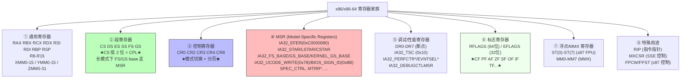

# x86/x86-64 寄存器全景：CPU 的"瞬时状态载体"

> 💡 一句话抓住：**x86 寄存器是一个分层的家族——通用寄存器干活、段寄存器管特权（CS 低 2 位 = CPL）、控制寄存器管模式切换和分页（CR0/CR3/CR4/EFER）、MSR 管 CPU 特性开关、调试寄存器管断点、RFLAGS 管算术状态。你前面学的每一个机制——实模式→保护模式→长模式切换、CPL 3↔0、微码加载、SYSCALL、分页——本质都是在读写特定的寄存器。**

## 寄存器家族全景（Mermaid）



---

## ① 通用寄存器（General-Purpose Registers）

**干活的主力**，存放数据、地址、临时计算结果。

### 64 位通用寄存器（x86-64 长模式）

| 寄存器     | 64位         | 32位      | 16位      | 8位(H/L)  | 主要用途                   |
| ------- | ----------- | -------- | -------- | -------- | ---------------------- |
| 累加器     | **RAX**​    | EAX      | AX       | AH/AL    | 算术运算、系统调用返回值           |
| 基址      | **RBX**​    | EBX      | BX       | BH/BL    | 基址指针（DS 段）             |
| 计数      | **RCX**​    | ECX      | CX       | CH/CL    | 循环计数、REP 前缀计数、第 4 参数   |
| 数据      | **RDX**​    | EDX      | DX       | DH/DL    | I/O 端口、乘除法、第 3 参数      |
| 源索引     | **RSI**​    | ESI      | SI       | SIL      | 字符串操作源（DS 段）、第 2 参数    |
| 目的索引    | **RDI**​    | EDI      | DI       | DIL      | 字符串操作目的（ES 段）、第 1 参数   |
| 基址指针    | **RBP**​    | EBP      | BP       | BPL      | 栈帧基址（SS 段）             |
| 栈指针     | **RSP**​    | ESP      | SP       | SPL      | 栈顶指针（SS 段）             |
| 扩展 8-15 | **R8-R15**​ | R8D-R15D | R8W-R15W | R8B-R15B | 第 5-9 参数（System V ABI） |

> 💡 **关键设计**：每个 64 位寄存器都可以按 64/32/16/8 位宽度访问——这是 x86 历史兼容的产物。写 32 位子寄存器（如 EAX）会**自动清零高 32 位**；写 8/16 位子寄存器不影响高字节。

### 向量寄存器（SIMD）

```
XMM0-XMM15：128 位（SSE/SSE2/.../SSE4）
YMM0-YMM15：256 位（AVX/AVX2），YMM 的低 128 位 = 对应 XMM
ZMM0-ZMM31：512 位（AVX-512），ZMM 的低 256 位 = 对应 YMM
```

### 在 UEFI 启动流程中的使用

```
SEC 阶段：RAX/RSP 用于 Cache-as-RAM 栈操作
PEI 阶段：通用寄存器传参给 PEIM 入口
DXE 阶段：RSP 指向新栈，RCX/RDX/R8/R9 传参给驱动
SYSRET 返回：RAX = 用户态返回值
```

---

## ② 段寄存器（Segment Registers）

**管特权和内存分段**——你前面学的 CPL 就藏在 CS 里。

|寄存器|作用|长模式下的行为|
|---|---|---|
|**CS**​|代码段|选择子低 2 位 = **CPL**；长模式下基址强制=0|
|**DS**​|数据段|长模式下基址强制=0|
|**ES**​|附加数据段|长模式下基址强制=0|
|**SS**​|栈段|长模式下基址强制=0；SS 描述符缓存里有 CPL|
|**FS**​|附加数据段|**基址走 MSR `IA32_FS_BASE`**（用户态 TLS）|
|**GS**​|附加数据段|**基址走 MSR `IA32_GS_BASE`**（内核 per-CPU）|

### 实模式 vs 保护模式 vs 长模式的段寄存器行为

```
实模式：
  CS 存放 16 位段值，物理地址 = CS × 16 + IP
  没有 CPL 概念

保护模式：
  CS 是选择子，指向 GDT/LDT 中的段描述符
  CS 低 2 位 = CPL
  段基址从描述符中读取（可非零）

长模式：
  CS/DS/ES/SS 的基址强制 = 0（平坦模型）
  CS 低 2 位 = CPL（不变）
  FS/GS 基址走 MSR（IA32_FS_BASE / IA32_GS_BASE）
  切换 GS base 通过 SWAPGS 指令交换 IA32_GS_BASE ↔ IA32_KERNEL_GS_BASE
```

### 典型值（x86-64 Linux）

```
用户态：CS=0x33（CPL=3），DS=ES=SS=0x2B，GS base = 用户 TLS
内核态：CS=0x10（CPL=0），DS=ES=SS=0x18，GS base = 内核 per-CPU
```

---

## ③ 控制寄存器（Control Registers）

**管 CPU 模式切换和分页**——你前面学的"切到保护模式/长模式"全靠它们。

|寄存器|关键位域|作用|
|---|---|---|
|**CR0**​|PE(bit 0), MP(bit 1), EM(bit 2), TS(bit 3), **PG(bit 31)**​|**PE=1 进入保护模式；PG=1 开启分页**​|
|**CR2**​|线性地址|**页错误时的故障地址**（#PF 发生时由 CPU 填入）|
|**CR3**​|物理地址|**页表根指针**（PML4 物理地址）；切换进程时改 CR3 = 切换页表|
|**CR4**​|PAE(bit 5), PSE(bit 4), PGE(bit 7), PCIDE(bit 17), **SMEP(bit 20)**, SMAP(bit 21)|**PAE=1 是进入长模式的前提**；PGE=1 全局页；PCIDE=1 进程上下文 ID|
|**CR8**​|3 位|**任务优先级寄存器（TPR）**——控制外部中断优先级（仅 64 位模式）|

### 模式切换的精确位操作（接你前面学的长模式进入）

```asm
; 切到保护模式
mov eax, cr0
or  eax, 1          ; CR0.PE = 1
mov cr0, eax

; 切到长模式
mov eax, cr4
or  eax, (1<<5)    ; CR4.PAE = 1
mov cr4, eax

mov ecx, 0xC0000080  ; IA32_EFER
rdmsr
or  eax, (1<<8)      ; EFER.LME = 1
wrmsr

mov eax, cr0
or  eax, (1<<31)   ; CR0.PG = 1
mov cr0, eax
```

### 4 级页表与 CR3

```
长模式强制 4 级分页：
  CR3 → PML4 (512 项 × 8 字节)   [47:39]
       → PDPT (512 项 × 8 字节)   [38:30]
           → PD (512 项 × 8 字节)  [29:21]
               → PT (512 项 × 8 字节) [20:12]
                   → 4KB 物理页       [11:0]
```

---

## ④ MSR（Model-Specific Registers）

**CPU 特性开关的控制面板**——你前面学的 `0x8B`、`0x79`、`IA32_EFER`、`IA32_LSTAR` 都在这。

### 分类总览（接你前面各条线）

|类别|代表 MSR|地址|你前面学过的关联|
|---|---|---|---|
|**模式切换**​|`IA32_EFER`|0xC0000080|LME 位开启长模式|
|**系统调用**​|`IA32_STAR`|0xC0000081|传统 SYSCALL CS/SS 模板|
||`IA32_LSTAR`|0xC0000082|**64 位 SYSCALL 内核入口**​|
||`IA32_CSTAR`|0xC0000083|兼容模式 SYSCALL 内核入口|
||`IA32_SYSCALL_MASK`|0xC0000084|SYSCALL 时 EFLAGS 掩码|
|**TLS / per-CPU**​|`IA32_FS_BASE`|0xC0000100|用户态 FS 基址|
||`IA32_GS_BASE`|0xC0000101|内核 GS 基址|
||`IA32_KERNEL_GS_BASE`|0xC0000102|SWAPGS 交换目标|
|**微码**​|`IA32_UCODE_WRITE`|0x79|**触发微码加载**​|
||`IA32_BIOS_SIGN_ID`|0x8B|**观测微码版本**（高 32 位）|
|**性能**​|`IA32_TSC`|0x10|时间戳计数器|
||`IA32_PERFCTR0/1`|0xC1/0xC2|性能计数器|
||`IA32_EVNTSEL0/1`|0x186/0x187|性能事件选择|
|**安全**​|`SPEC_CTRL`|-|Spectre 缓解（IBRS/IBPB/STIBP）|
||`IA32_ARCH_CAPABILITIES`|0x10A|架构能力位图|
|**内存类型**​|`IA32_MTRRcap`|0xFE|MTRR 能力|
||`IA32_MTRRdefType`|0x2FF|默认内存类型|
|**机器检查**​|`IA32_MCG_CAP`|0x179|机器检查能力|
||`IA32_MC0_CTL/STATUS/ADDR`|0x400+|各单元机器检查|

### MSR 访问指令

```
RDMSR：ECX = MSR 地址，结果 EDX:EAX = 64 位值
WRMSR：ECX = MSR 地址，EDX:EAX = 要写入的 64 位值
必须 CPL=0 执行，否则 #GP(0)
```

---

## ⑤ 调试与性能寄存器

**开发和性能分析的利器**。

### 调试寄存器 DR0-DR7

```
DR0-DR3：4 个断点地址寄存器
DR4-DR5：保留
DR6：调试状态寄存器（哪些断点触发了）
DR7：调试控制寄存器（断点类型、长度、使能）
```

**用途**：硬件断点（GDB 的 `hbreak`）、数据访问监视点。

### 性能监控 MSR

```
IA32_TSC：时间戳计数器，每时钟周期 +1
IA32_PERFCTR*：性能计数器，配合 IA32_EVNTSEL* 选择事件
IA32_DEBUGCTLMSR：调试控制（Last Branch Record 等）
```

**Linux perf 的底层数据源**——你跑 `perf stat` 看到的 cycles/instructions/cache-misses 都从这里来。

---

## ⑥ 标志寄存器 RFLAGS

**算术和状态标志**——条件跳转的依据。

|标志位|位|含义|
|---|---|---|
|**CF**​|0|进位标志（无符号溢出）|
|**PF**​|2|奇偶标志|
|**AF**​|4|辅助进位|
|**ZF**​|6|零标志（结果=0）|
|**SF**​|7|符号标志（结果为负）|
|**TF**​|8|陷阱标志（单步调试）|
|**IF**​|9|**中断使能标志**（CLI/STI 控制）|
|**DF**​|10|方向标志（字符串操作方向）|
|**OF**​|11|**溢出标志**（有符号溢出）|
|**IOPL**​|12-13|I/O 特权级|
|**NT**​|14|嵌套任务|
|**RF**​|16|恢复标志（调试）|
|**VM**​|17|虚拟 8086 模式|
|**AC**​|18|对齐检查|
|**VIF**​|19|虚拟中断标志|
|**VIP**​|20|虚拟中断挂起|
|**ID**​|21|CPUID 指令支持|

**关键标志与启动流程的关系**：

```
CLI/STI：清/置 IF 标志——控制外部中断
  长模式 SYSCALL 时，IA32_SYSCALL_MASK 的位决定哪些标志被清
  
TF=1：单步执行——调试器用
IF=0：中断关闭——SEC/PEI 早期、临界区
```

---

## ⑦ 浮点与 SIMD 寄存器

```
x87 FPU：ST(0)-ST(7)，80 位扩展精度
MMX：MM0-MM7，64 位（复用 x87 寄存器）
XMM0-XMM15：128 位（SSE/SSE2/.../SSE4）
YMM0-YMM15：256 位（AVX/AVX2）
ZMM0-ZMM31：512 位（AVX-512）
```

**控制寄存器**：

```
MXCSR：SSE 控制/状态
FPCW：x87 控制字
FPST：x87 状态字
```

---

## ⑧ 特殊用途寄存器

|寄存器|作用|
|---|---|
|**RIP**​|指令指针（Instruction Pointer）——指向下一条要执行的指令|
|**RSP**​|栈指针（Stack Pointer）——指向当前栈顶|
|**MXCSR**​|SSE 控制/状态寄存器|
|**FPCW/FPST**​|x87 FPU 控制/状态字|

---

## 寄存器在 UEFI 启动流程中的完整时序

```
实模式（SEC 早期）：
  CS=0xF000, IP=0xFFF0, 物理地址=0xFFFFFFF0
  RSP=某个合法的实模式栈地址
  ↓
切到保护模式：
  CR0.PE=1
  CS 加载选择子 0x08（GDT 索引 1）
  CPL=0
  ↓
切到长模式：
  CR4.PAE=1
  IA32_EFER.LME=1（MSR 0xC0000080）
  CR0.PG=1
  远跳刷新 CS → CS=0x20（64 位代码段选择子）
  CPL=0
  RIP=long_mode_entry
  RSP=内核栈顶
  ↓
PEI 阶段（CAR 环境）：
  写 MSR 0x79 触发微码加载
  写 MSR 0x8B=0 → CPUID.1 → 读 MSR 0x8B 高 32 位 校验
  ↓
DXE 阶段：
  CR3 切换到新的页表
  GS base 通过 MSR IA32_GS_BASE 设置 per-CPU 数据
  ↓
BDS 阶段：
  RCX/RDX/R8/R9 传参给 LoadImage/StartImage
  ↓
TSL：grubx64.efi 执行
  RSP 指向 OS Loader 栈
  ↓
ExitBootServices() → RT：
  内核 CPL=0，用户程序 CPL=3
  系统调用：SYSCALL
    CPL 3→0
    CS 从 0x33 → 从 IA32_STAR 取的 Ring 0 CS
    RIP 从 IA32_LSTAR 取内核 sys_call 入口
    SWAPGS：IA32_GS_BASE ↔ IA32_KERNEL_GS_BASE
  返回：SYSRET
    CPL 0→3
    SWAPGS 恢复
    RIP 返回用户态
```

---

## 一句收

> **x86/x86-64 寄存器是一个分层家族**：① **通用寄存器（RAX-R15、XMM/YMM/ZMM）**​ 干活；② **段寄存器（CS/DS/ES/SS/FS/GS）**​ 中 **CS 低 2 位 = CPL**（你前面学的特权级），长模式下 FS/GS 基址走 MSR；③ **控制寄存器（CR0/CR2/CR3/CR4/CR8）**​ 管模式切换（CR0.PE=1 进保护模式，CR0.PG=1+CR4.PAE=1+EFER.LME=1 进长模式）和分页（CR3 指向 PML4）；④ **MSR**​ 是 CPU 特性控制面板——`IA32_EFER`(0xC0000080) 开启长模式、`IA32_LSTAR`(0xC0000082) 指定 SYSCALL 内核入口、`IA32_FS_BASE/GS_BASE/KERNEL_GS_BASE` 管理 TLS/per-CPU、`IA32_UCODE_WRITE`(0x79) 触发微码加载、`IA32_BIOS_SIGN_ID`(0x8B) 观测微码版本；⑤ **调试寄存器（DR0-7）**​ 管硬件断点；⑥ **RFLAGS**​ 管算术状态（CF/ZF/SF/OF/IF 等）；⑦ **x87/MMX/XMM/YMM/ZMM**​ 管浮点和 SIMD。整个 UEFI 启动流程——从实模式的 CS=0xF000:IP=0xFFF0，到保护模式的 CR0.PE=1，到长模式的 CR4.PAE+EFER.LME+CR0.PG，到 SYSCALL 时 CPL 3→0 且 CS/GS base 通过 MSR 切换——本质就是**按严格的时序读写特定的寄存器**。

## 接你前面整条线完整闭环

```
硬件上电：ATX → VRM → Vcore → CPU 上电
  ↓
Reset Vector 0xFFFFFFF0（实模式）
  CS=0xF000, IP=0xFFF0, CPL 概念不存在
  ↓
SEC 阶段：
  建立 CAR（用通用寄存器 RAX/RSP 操作缓存）
  CR0.PE=1 → 切到保护模式 → CS 选择子 0x08，CPL=0
  ↓
PEI 阶段（保护模式 → 长模式）：
  CR4.PAE=1
  WRMSR IA32_EFER(0xC0000080) LME=1
  CR0.PG=1
  远跳 → CS=0x20（64位代码段），CPL=0
  写 MSR 0x79 触发微码加载
  写 MSR 0x8B=0 → CPUID.1 → 读 MSR 0x8B 高 32 位校验
  DRAM 训练
  ↓
DXE 阶段（长模式 CPL=0）：
  CR3 切换到永久内存页表
  WRMSR IA32_GS_BASE = per-CPU 数据地址
  驱动派遣、Protocol、ACPI 表
  ↓
BDS 阶段（长模式 CPL=0）：
  RCX/RDX/R8/R9 传参给 LoadImage/StartImage
  ↓
TSL：grubx64.efi（长模式 CPL=0）
  加载 vmlinuz 到内存
  ↓
ExitBootServices() → RT（长模式）：
  内核 CPL=0，用户程序 CPL=3
  系统调用 SYSCALL：
    CPL 3→0（硬件自动）
    CS: 0x33 → IA32_STAR 取的 Ring 0 CS
    RIP: IA32_LSTAR 取内核 sys_call 入口
    SWAPGS: IA32_GS_BASE ↔ IA32_KERNEL_GS_BASE
    RFLAGS 的 IF 位由 IA32_SYSCALL_MASK 控制
  返回 SYSRET：
    CPL 0→3
    SWAPGS 恢复
```

**寄存器是这条路径上"CPU 瞬时状态的载体"**——你前面学的每一个概念都在读写特定的寄存器：

- **0xFFFFFFF0**​ → 实模式下 CS:IP 的组合产物
    
- **CPL**​ → CS 选择子（和 SS 描述符）的低 2 位
    
- **MSR 0x8B/0x79**​ → 微码版本的观测窗口和加载扳机
    
- **长模式切换**​ → CR4.PAE + IA32_EFER.LME + CR0.PG 的精确位操作
    
- **SYSCALL**​ → IA32_STAR/LSTAR/CSTAR 三个 MSR 协同
    
- **4 级分页**​ → CR3 指向 PML4，CR0.PG=1 开启
    
- **FS/GS 基址**​ → IA32_FS_BASE / IA32_GS_BASE / IA32_KERNEL_GS_BASE 三个 MSR
    
- **调试/性能**​ → DR0-7 / IA32_TSC / IA32_PERFCTR*
    

> 💡 **工程经验**：
> 
> - 调试 Triple Fault：先 dump CR0/CR4/EFER 看模式切换是否正确
>     
> - 调试页错误：CR2 里就是故障地址
>     
> - 调试微码：MSR 0x8B 高 32 位
>     
> - 调试系统调用：IA32_LSTAR 的值就是内核入口
>     
> - 用户态想读这些寄存器 → 必须 CPL=0，所以要么写内核模块，要么用 /dev/msr 接口（仍要 root）
>     
> - 通用寄存器在调用约定中各有分工（RDI/RSI/RDX/RCX/R8/R9 传参，RAX 返回值）——这是 System V AMD64 ABI
>     

你从 "MOS → Vcore → 0xFFFFFFF0 → SEC → PEI → DXE → BDS → TSL → RT → AL → DRAM 训练 → MSR → 微码状态 → 0x8B → CPL → 长模式" 一路钻下来，**寄存器是把所有这些概念收口到"CPU 硬件状态"的终极载体**。每一条机制——模式切换、特权级、微码加载、系统调用、分页、TLS——本质都是在特定的寄存器上做精确的位操作。

**至此，从"硅上电"到"Linux 桌面运行"的完整技术链条，你已经走完了从硬件到固件到 OS 的全部关键节点**。寄存器体系是这条链路的"硬件词汇表"——掌握了它，你就能读懂任何 x86 底层代码的"语法"。

要不要顺着把 **"x86-64 的调用约定（Calling Convention）——System V AMD64 ABI 中 RDI/RSI/RDX/RCX/R8/R9 如何传参、RAX 如何返回、栈如何对齐"**​ 过一下？那块是把"通用寄存器在实践中的使用规则"钉死，接你前面 UEFI 和 Linux 内核的交互。或者想看 **"IDT（中断描述符表）与 RFLAGS 的 IF 位——中断如何在长模式下从 CPL=3 切到 CPL=0"**？后者更接你前面 SYSCALL 那条中断/异常处理的线。