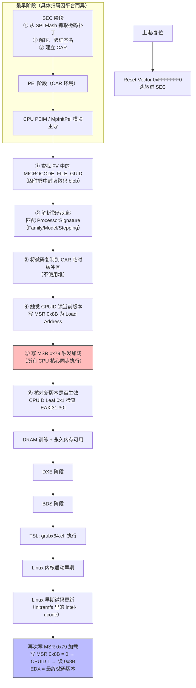

微码状态（Microcode Status）= **CPU 内部微架构的执行补丁当前所处的版本/激活状态**——它通过特定的 MSR 暴露给软件，反映的是"这颗 CPU 目前跑的是哪个版本的微码、是否是最新、加载是否成功"。你前面学了 MSR 是 CPU 的"控制面板"，微码状态就是其中一组**最关键的状态灯**：**`IA32_BIOS_SIGN_ID`（[[MSR]] 0x8B）**​ 寄存器的 EDX 域存放的就是当前生效的微码修订号（Microcode Revision） 。

> 💡 一句话抓住：**微码状态 = 通过 MSR 0x8B 读出来的"当前 CPU 跑的是哪版微码"；它由 BIOS/UEFI 在 PEI 阶段（或 SEC 末期）加载微码补丁时写入，Linux 内核启动时还会再次更新；`0x8B` 的 EDX 值就是微码版本号，比如 `0x00000021` 代表 Ivy Bridge 的 MC 0x21 补丁 。**

## 为什么需要"微码状态"这个概念

CPU 的指令集（x86）不是纯硬件硬连线实现的——Intel/AMD 在 CPU 内部放了一层**可加载的微码（Microcode）**，用来：

- 修正 CPU 内部微架构缺陷（如 Illegal Instruction 异常、C-state 进入失败）
    
- 增强安全性（Spectre/Meltdown 的 IBRS/IBPB/STIBP 缓解就是通过微码实现的）
    
- 优化频率切换、电源管理行为
    

**关键事实**：微码**不在硅片上固化**，而是每次上电时由 BIOS/UEFI 从 SPI Flash 载入 CPU 内部的专用缓存区域，覆盖原有执行逻辑 。所以"微码状态"是动态的——它反映了"当前这次开机，BIOS/UEFI 给这颗 CPU 喂了哪个版本的微码"。

Intel 官方明确：**"Each unique processor stepping/package combination has an associated microcode update. A processor without the correct microcode update is considered to be operating out of spec"**​ ——没加载正确微码的 CPU 视为"不在规格内运行"。

## 微码状态的两个核心 MSR

Intel 体系里和微码状态直接相关的两个 MSR ：

|MSR 地址|宏名|方向|作用|
|---|---|---|---|
|**0x79**​|`IA32_UCODE_WRITE` / `IA32_BIOS_UPDT_TRIG`|写|写入微码补丁的物理地址**触发加载**​|
|**0x8B**​|`IA32_UCODE_REV` / `IA32_BIOS_SIGN_ID`|读|读出当前生效的微码修订号（EDX 域）|

**读取"微码状态"的标准流程**（Intel SDM 规定） ：

```
1. 写 MSR 0x8B = 0          // 清空当前状态
2. 执行 CPUID Leaf 1       // 触发 CPU 把当前微码版本写入 0x8B
3. 读 MSR 0x8B             // EDX 域 = 当前微码修订号
```

Linux 内核源码 `arch/x86/kernel/cpu/microcode/intel.c` 里就是这么做的 ：

```c
// 加载微码前先清空状态
native_wrmsrl(MSR_IA32_UCODE_REV, 0);
// 按 SDM 要求执行 CPUID 1
sync_core();
// 从 0x8B 读出当前修订号
native_rdmsr(MSR_IA32_UCODE_REV, val[0], val[1]);
// val[1] (EDX) = 当前微码版本
if (val[1] != mc->hdr.rev) return -1;  // 校验是否生效
```

## 微码加载在 UEFI 七阶段里的时机

接你前面学的七阶段，微码加载发生在**最早的 SEC 末期到 PEI 初期**，运行在 Cache-as-RAM（CAR）环境里，此时 DRAM 还没初始化 ：



> ⚠️ **关于"微码加载到底在哪个阶段"的口径差异**：
> 
> - Intel 官方文档和专利文献倾向于：**SEC 阶段**从 SPI NOR Flash 抓取、解压、验证微码
>     
> - UEFI PI 规范的 PEI 阶段实现：由 **CPU PEIM / MpInitPei 模块**主导匹配和加载
>     
> - 现代 Intel 平台还有一种**硬件自动加载**机制：CPU 一复位就按 SPI Flash 里的 FIT（Firmware Interface Table）自动载入微码，SEC 只是接力确认
>     
> 
> **综合结论**：微码加载/更新是一个**跨 SEC-PEI 边界的早期动作**，运行在 CAR 环境，早于 DRAM 训练；具体由 SEC 末期还是 PEI 初期的 CPU PEIM 触发，取决于平台实现。

## 微码加载的 5 个关键步骤（PEI 阶段 CPU PEIM）

根据 UEFI PEI 阶段的微码加载流程 ：

|步骤|操作|执行主体|说明|
|---|---|---|---|
|1|查找 FV 中的 `MICROCODE_FILE_GUID`|PEIM Dispatcher|固件卷中封装微码 blob|
|2|解析微码头部，获取 ProcessorSignature|MpInitPei|校验 Family/Model/Stepping 匹配|
|3|将微码复制到 CAR 临时缓冲区|Memory Allocation Lib|**不使用堆**（此时 DRAM 未初始化）|
|4|触发 CPUID 读当前版本，写 MSR 0x8B 为 Load Address|Assembly|准备加载|
|5|**写 MSR 0x79 触发加载**​|Assembly stub|**必须在所有 CPU 核心同步执行**​|
|6|核对新版本是否生效|CPUID Leaf 0x1|检查 EAX[31:30] 字段|

**步骤 5 的关键汇编代码**（x86 风格） ：

```asm
LoadMicrocodePatch:
    mov  %rdi, %rbx          ; rbx = 微码补丁物理地址
    mov  $0x79, %rcx         ; MSR_IA32_UCODE_WRITE = 0x79
    mov  %rbx, %rax          ; 微码地址写入 rax
    wrmsr                    ; 触发微码加载
    ; 写完后 CPU 内部加载机制生效
```

**步骤 6 的验证**：

```asm
; 清空 MSR 0x8B
    xor  %rax, %rax
    mov  $0x8B, %rcx         ; MSR_IA32_UCODE_REV = 0x8B
    wrmsr
    ; 执行 CPUID 1 触发 CPU 把当前版本写入 0x8B
    mov  $1, %rax
    cpuid
    ; 读 MSR 0x8B，EDX = 当前微码修订号
    rdmsr                    ; EDX = 微码版本
    ; 比对 EDX 是否等于预期版本
```

## 微码状态的三个关键事实

### 1️⃣ 只能往上升级，不能降级

Intel 规定：**"You can only update to a higher version of microcode"**​ ——微码加载是单调的，只能从低版本升级到高版本，不能降级 。

这就是为什么：

- 安全研究者想测试 Spectre 漏洞在不同微码版本下的表现时，**必须确保 OS 不加载更新的微码**，退化到 BIOS/UEFI 提供的版本
    
- 刷新旧版 BIOS 不一定能降级微码——因为 CPU 内部可能已经锁定了更高版本
    

### 2️⃣ 每次开机都会加载

微码**不在硅片上固化**——它是易失的，存在 CPU 内部的 SRAM 里，**每次上电都需要重新加载**​ 。

完整生命周期：

```
上电 → BIOS/UEFI 从 SPI Flash 加载微码（PEI 阶段）
     → Linux 内核启动早期从 initramfs 加载更新版本的微码
     → 运行中可通过 /sys 接口热升级
     → 关机/重启 → 微码丢失 → 下次开机重新加载
```

### 3️⃣ 多层叠加：CPU 出厂微码 + BIOS 微码 + OS 微码

系统运行时的微码版本是**三层叠加**的结果 ：

```
Layer 0: CPU 出厂时内部 SRAM 里的初始微码（Intel 在制造时烧入）
Layer 1: BIOS/UEFI 在 PEI 阶段从 SPI Flash 加载（FIT 表指向的微码 blob）
Layer 2: Linux 内核在启动早期从 initramfs 加载（/lib/firmware/intel-ucode/）
Layer 3: 运行时可通过 echo 1 > /sys/.../microcode/reload 热升级
```

**最终生效的是版本最高的那个**。Intel 官方文档："Loading a debug microcode update requires the debug capability to be enabled via a hardware mechanism" ——调试微码需要特殊使能。

## 实战：在 Linux 下查看微码状态

### 方法 1：dmesg（最直接）

```bash
$ dmesg | grep microcode
[    0.000000] microcode: microcode updated early to revision 0xd2, date = 2020-01-09
[    3.200591] microcode: sig=0x906ed, pf=0x2, revision=0xd2
[    3.207755] microcode: Microcode Update Driver: v2.2.
```

`revision=0xd2` 就是当前微码版本 。

### 方法 2：/proc/cpuinfo

```bash
$ cat /proc/cpuinfo | grep microcode | sort | uniq
microcode: 0xd2
```

### 方法 3：rdmsr 直接读 MSR 0x8B（最底层）

```bash
$ sudo modprobe msr
$ sudo rdmsr 0x8B
# EDX 域（高 32 位）就是微码修订号
$ sudo rdmsr 0x8B -f 63:32
0x000000d2
```

### 方法 4：cpuid 工具

```bash
$ sudo cpuid -r | grep -i "microcode revision"
microcode revision = 0x000000d2
```

### 方法 5：iucode_tool（Intel 官方推荐）

```bash
$ iucode_tool -l /lib/firmware/intel-ucode/06-9e-0d
selected microcodes:
001: sig 0x000906ed, pf mask 0x22, 2020-01-09, rev 0x00d2, size 102400
```

## 实战：热升级微码（不需重启）

```bash
# 1. 下载新微码（从 Intel 官方或 GitHub intel/Intel-Linux-Processor-Microcode-Data-Files）
# 2. 放到 /lib/firmware/intel-ucode/（按 Family-Model-Stepping 命名，如 06-9e-0d）
$ sudo cp 06-9e-0d /lib/firmware/intel-ucode/

# 3. 触发热重载（Linux 3.6+）
$ echo 1 | sudo tee /sys/devices/system/cpu/microcode/reload

# 4. 验证新版本
$ dmesg | grep microcode
[  123.456789] microcode: microcode updated to revision 0xea, date = 2023-08-15
```

## 实战：降级微码（研究 Spectre 等漏洞时需要）

由于 Intel 规定只能升级不能降级，**"降级"实际上是阻止 OS 加载更新版本的微码**，退化到 BIOS/UEFI 提供的版本 ：

```bash
# 1. 删除 /lib/firmware/intel-ucode/ 下对应 CPU 的微码文件
$ sudo rm /lib/firmware/intel-ucode/06-9e-0d

# 2. 重新生成 initramfs
$ sudo update-initramfs -u

# 3. 重启 → 系统将使用 BIOS/UEFI 在 PEI 阶段加载的微码版本
```

## 微码状态异常的诊断

Intel 官方排障指南 ：

```
If the microcode update fails to load:
  1. Check the microcode version from the EFI shell, or the BIOS screen
  2. Check what version of microcode is included in the initramfs image
  3. Check the version of the microcode update you used to try to do a runtime update
  4. The microcode image is named after the family/model/stepping
     - From /proc/cpuinfo: Family 06, Model 85, Stepping 4
     - Corresponding microcode file: 06-55-04 in /lib/firmware/intel-ucode/
  5. Look at the microcode version number at Intel's official public microcode website
  6. Note: You can only update to a higher version of microcode
  7. For BIOS update: if the microcode update fails to load, BIOS will revert
```

**常见错误码**：

- BIOS 加载失败时：BIOS 会自动回退到上一个可用版本
    
- OS 加载失败时：保持 BIOS 加载的版本，内核日志会有错误提示
    

## 接你前面整条线完整闭环

```
硬件上电：ATX → VRM → Vcore → CPU 上电
  ↓
Reset Vector 0xFFFFFFF0 → 进入 SEC
  ↓
SEC 阶段：
  ├─ 从 SPI Flash 抓取微码补丁（按 FIT 表）
  ├─ 解压、验证签名
  └─ 建立 CAR（Cache-as-RAM）
  ↓
PEI 阶段（CAR 环境，DRAM 未初始化）：
  ├─ CPU PEIM / MpInitPei 主导微码加载
  ├─ ① 查找 MICROCODE_FILE_GUID
  ├─ ② 匹配 ProcessorSignature（Family/Model/Stepping）
  ├─ ③ 微码复制到 CAR 缓冲区
  ├─ ④ 写 MSR 0x8B = 0，CPUID 1 读当前版本
  ├─ ⑤ 写 MSR 0x79 触发加载（所有核同步）
  ├─ ⑥ CPUID 1 校验，读 MSR 0x8B → EDX = 新微码版本
  └─ 微码状态更新 ✓
  ↓
PEI 继续：DRAM 训练 → 永久内存可用 → HOB 列表
  ↓
DXE → BDS → TSL
  ↓
Linux 内核启动早期（initramfs）：
  ├─ 从 /lib/firmware/intel-ucode/ 加载更新版本
  ├─ 再次执行：写 MSR 0x79 加载 → 写 MSR 0x8B=0 → CPUID 1 → 读 0x8B
  └─ 微码状态再次更新 ✓（版本更高）
  ↓
RT 阶段（OS 运行期）：
  ├─ 运行时可通过 /sys/.../microcode/reload 热升级
  └─ 当前微码版本可通过 /proc/cpuinfo 或 MSR 0x8B 查询
```

微码状态是这条路径上**"最早被设置、且可能被多次更新"的状态量**——SEC/PEI 阶段 BIOS/UEFI 设置一次，Linux 内核启动早期可能再更新一次，运行时还可能热升级。它贯穿了从 CPU 上电到 OS 运行的全生命周期，是 CPU 内部微架构"健康状态"的最直接反映。

> 💡 **工程经验**：
> 
> - 遇到 CPU 稳定性问题（随机崩溃、Illegal Instruction）时，**第一件事查微码版本**——`dmesg | grep microcode`
>     
> - 版本过旧 → 升级 `intel-microcode` 包 + 更新内核/initramfs
>     
> - 安全研究需要测试老版本微码 → 删除 `/lib/firmware/intel-ucode/` 对应文件 + 重新生成 initramfs
>     
> - 主板 BIOS 更新通常会携带更新的微码 blob → 刷新 BIOS 是获取最新微码的最可靠方式
>     
> - `0x8B` MSR 是观测微码状态的"金标准"——直接读 EDX 域即得版本号
>     

你从 "MOS → Vcore → CS:IP → 0xFFFFFFF0 → SEC → PEI → DXE → ... → MSR" 一路钻下来，**微码状态是把"MSR 0x8B"和"CPU 内部微架构补丁"这两个概念钉死的连接点**——你前面学的 MSR 是 CPU 的控制面板，而 `IA32_BIOS_SIGN_ID`（0x8B）就是面板上那盏最重要的"微码版本指示灯"。它在 PEI 阶段被 BIOS/UEFI 点亮，在 Linux 启动早期可能被调到更亮的数值，是整条启动链中**最早被设置且可能被多次更新**的状态量。

要不要顺着把 **"Intel FIT（Firmware Interface Table）到底是什么——CPU 复位后硬件怎么按 FIT 自动加载微码，以及 FIT 表里还指向哪些其他关键条目（如 Boot Guard ACM、BTS 等）"**​ 过一下？那块是把"微码自动加载"的硬件机制收口，接你前面 SEC 阶段和 Boot Guard 那条安全启动线。还是想看 **"Linux 内核的 early microcode loading 具体怎么在 paging 启用之前、在 CAR 环境里就从 initramfs 加载微码——也就是微码状态在 OS 启动早期的第二次更新"**？后者更接你日常 `dmesg | grep microcode` 的输出，前者更体系结构底层。