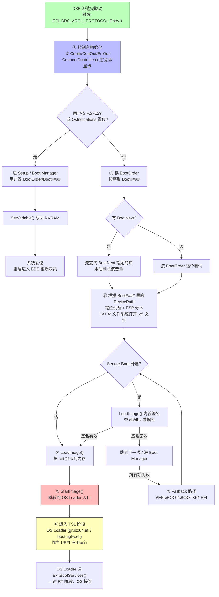

BDS = **Boot Device Selection（启动设备选择）**——UEFI 七阶段里的第四阶段，DXE 把所有驱动派遣完、服务表建好后，**通过 `EFI_BDS_ARCH_PROTOCOL` 把控制权交给 BDS**。它的本质定位是：**DXE 提供"机制"（Mechanism），BDS 执行"策略"（Policy）**——DXE 不管从哪启动，BDS 才根据 NVRAM 里的配置决定从哪个设备、哪个 EFI 应用启动。

> 💡 一句话抓住：**BDS 就是你在开机时看到的"按 F2 进 Setup / F12 选启动项"背后的那个固件策略引擎，它读 NVRAM、连设备、找 EFI 应用、LoadImage + StartImage 把控制权交给 OS Loader。**

## 在 UEFI 七阶段里的位置

```
SEC → PEI → DXE → [BDS] → TSL → RT → AL
                 ↑
                 你问的这阶段
                 DXE 派遣完所有驱动后进入
```

**进入条件**（PI 规范严格要求）：DXE Dispatcher 必须完成一个完整的派遣周期——所有当前可发现、依赖已满足的 DXE 驱动都被加载执行后，才通过 `EFI_BDS_ARCH_PROTOCOL` 的 `Entry()` 进入 BDS。这样保证 BDS 开始时，**所有设备协议都已就绪**：Block I/O、Simple File System、Graphics Output、Console 等全可用。

## BDS 的三大任务

PI 规范 + EDK2 实现里，BDS 主要干三件事：

### 1️⃣ 控制台初始化（Console Initialization）

读取 NVRAM 变量 `ConIn` / `ConOut` / `ErrOut`，通过 `ConnectController()` 把对应的控制台驱动绑到设备：

- **ConOut**：显卡 → `EFI_GRAPHICS_OUTPUT_PROTOCOL`（图形输出）/ `EFI_SIMPLE_TEXT_OUTPUT_PROTOCOL`（文本）
    
- **ConIn**：键盘 → `EFI_SIMPLE_TEXT_INPUT_PROTOCOL`（PS2/USB 键盘）
    
- **ErrOut**：错误输出设备
    

这一步做完，固件才能"显示 Logo / 响应用户按键 / 画启动菜单"。

### 2️⃣ 设备连接与驱动加载（Device Connection）

通过 `ConnectController()` 枚举并连接所有可启动设备：

- 块设备（硬盘/NVMe/SATA/USB 盘）→ 产生 `EFI_BLOCK_IO_PROTOCOL` + `EFI_SIMPLE_FILE_SYSTEM_PROTOCOL`
    
- 网络设备 → 产生 `EFI_LOAD_FILE_PROTOCOL`（PXE/HTTP Boot 用）
    
- 如果发现新固件卷里有未派遣的驱动 → **重新触发 DXE Dispatcher**​ 加载更多驱动，然后重试
    

### 3️⃣ 执行启动策略（Boot Policy——核心使命）

这是 BDS 的"灵魂"——根据 NVRAM 里的启动变量，按策略找到 OS Loader 并加载执行。

## BDS 的 NVRAM 变量体系（策略的配置源）

BDS 是完全数据驱动的——它自己的行为由 NVRAM 里一组全局变量决定：

|变量|类型|作用|
|---|---|---|
|**BootOrder**​|UINT16 数组|启动项尝试顺序，如 `[0001, 0002, 0000]`|
|**Boot####**​|EFI_LOAD_OPTION|单个启动项：设备路径 + EFI 文件路径 + 参数|
|**BootNext**​|UINT16 单值|仅下次启动生效的优先项（用后删除，防循环）|
|**BootCurrent**​|UINT16 单值|固件写入，指示本次用的启动项编号|
|**Timeout**​|UINT16|启动菜单等待时间（秒）|
|**DriverOrder**​ / **Driver####**​|—|启动前加载的额外驱动|
|**SysPrepOrder**​ / **SysPrep####**​|—|启动前运行的系统准备应用|
|**ConIn**​ / **ConOut**​ / **ErrOut**​|设备路径|控制台设备|
|**OsIndications**​|位掩码|用户请求进 Setup / 进 Boot Manager 等|

> 💡 `efibootmgr -v`（Linux）或 `bcdedit /enum firmware`（Windows）看到的就是这些 NVRAM 变量。你改启动顺序，本质就是改 `BootOrder`。

## BDS 的执行流程（Mermaid 详图）



## 关键流程逐步拆解

### 步骤 1：控制台起来

BDS 入口第一件事——让固件"能看能听"：

```c
// 伪代码
gBS->ConnectController(ConInHandle, NULL, NULL, TRUE);   // 连键盘
gBS->ConnectController(ConOutHandle, NULL, NULL, TRUE);  // 连显卡
// 此时固件可以显示 Logo、响应用户按键
```

如果用户按了 **F2 / Del**​ → 进 Setup（固件设置 UI）；按了 **F12 / Esc**​ → 进 Boot Manager（临时选启动项）。这些都是 BDS 在轮询用户的按键。

### 步骤 2：读 BootOrder，逐个尝试 Boot####

```c
// 伪代码
BootOrder = GetVariable("BootOrder");  // 如 [0001, 0002, 0000]

foreach (BootOptionNum in BootOrder) {
    BootOption = GetVariable("Boot" + BootOptionNum);  // 如 Boot0001
    // BootOption 内含 DevicePath + FilePath
    // 示例: HD(1,GPT,...)/\EFI\ubuntu\grubx64.efi
    
    Status = TryBootOption(BootOption);
    if (Status == SUCCESS) break;  // 启动成功，进 TSL
    // 否则继续下一个
}
```

### 步骤 3：定位设备 + ESP 分区 + FAT32 文件系统

`Boot####` 里的 `DevicePath` 是 UEFI 标准的可序列化路径，由一系列节点组成：

```
PCI Root Bridge → PCI 设备 → NVMe 控制器 → 命名空间 → 分区 → 文件路径
   ↓
AcpiDevicePath → PciRootDevicePath → MsgDevicePath → 
CtrlDevicePath → NamespaceDevicePath → HardDriveDevicePath → FilePathDevicePath
```

BDS 按这个路径：

1. 通过 `ConnectController()` 把驱动绑到这条路径上的每个设备
    
2. 找到 ESP 分区（GPT 类型 GUID 标识的标准 EFI 系统分区）
    
3. 挂上 FAT32 文件系统（DXE 的 FAT 驱动提供 `EFI_SIMPLE_FILE_SYSTEM_PROTOCOL`）
    
4. 按 `FilePath` 打开 `.efi` 文件（如 `\EFI\ubuntu\grubx64.efi`）
    

### 步骤 4：Secure Boot 签名校验（如果开启）

如果固件开启了 Secure Boot，`LoadImage()` 内部会：

1. 计算 EFI 文件的 Hash
    
2. 用 db（允许）和 dbx（禁止）数据库里的密钥验签名
    
3. 签名有效且在 db、不在 dbx → 继续加载
    
4. 否则 → 拒绝加载，BDS 跳到下一项
    

### 步骤 5：LoadImage + StartImage

```c
// 加载 OS Loader 到内存
Status = gBS->LoadImage(FALSE, gImageHandle, BootOption->FilePath, 
                        NULL, 0, &ImageHandle);
if (EFI_ERROR(Status)) goto try_next;

// 设置 Watchdog 定时器（5分钟，超时自动重启）
gBS->SetWatchdogTimer(5 * 60, 0, NULL);

// 跳转到 OS Loader 入口——从此 UEFI 失去控制权
Status = gBS->StartImage(ImageHandle, NULL, NULL);
// 如果 StartImage 返回 = 启动失败
gBS->SetWatchdogTimer(0, 0, NULL);
```

### 步骤 6：进入 TSL 阶段

`StartImage()` 成功后，CPU 跳到 OS Loader（如 `grubx64.efi`）的入口——**此时进入 TSL（Transient System Load）阶段**。OS Loader 仍然是一个 UEFI 应用程序，可以继续调用 Boot Services：

- 读取内核文件
    
- 读取 initramfs
    
- 设置 boot params
    
- 最终调用 `ExitBootServices()` → 进入 RT 阶段，OS 内核完全接管
    

### 步骤 7：Fallback 路径（兜底）

如果 `BootOrder` 中所有 `Boot####` 都失败（或 `BootOrder` 为空），BDS 会尝试标准 Fallback 路径：

```
\EFI\BOOT\BOOTX64.EFI    (x86-64)
\EFI\BOOT\BOOTIA32.EFI   (x86-32)
\EFI\BOOT\BOOTAA64.EFI   (ARM64)
```

这就是为什么所有 Linux 发行版安装时都会往 ESP 复制一份到 `\EFI\BOOT\BOOTX64.EFI`——保证即使 NVRAM 启动项丢了，主板也能从硬盘启动。

## BDS 与 DXE 的"机制/策略"分离（架构精髓）

这是 UEFI 相对传统 BIOS 最大的进步：

```
┌─────────────────────────────────────────────────┐
│ DXE 阶段：提供"机制"（Mechanism）                │
│   • 发现硬件                                     │
│   • 初始化驱动                                   │
│   • 暴露 Protocol（BlockIo/SimpleFileSystem/GOP）│
│   • 不关心从哪启动                               │
└─────────────────────────────────────────────────┘
                    ↓ 控制权
┌─────────────────────────────────────────────────┐
│ BDS 阶段：执行"策略"（Policy）                   │
│   • 读 NVRAM 启动变量                            │
│   • 按 BootOrder 决定从哪启动                     │
│   • 连接设备、加载 OS Loader                      │
│   • 定制化（Setup UI / Boot Manager）            │
│   • 不碰硬件细节，只消费 DXE 的 Protocol         │
└─────────────────────────────────────────────────┘
```

**好处**：

- 改启动策略（调 BootOrder、加自定义启动项）不需要改 DXE 核心代码
    
- 跨平台可移植：不同主板的 BDS 策略可定制，DXE 驱动通用
    
- 可维护性爆炸：OS 可通过 `efibootmgr` / `bcdedit` 直接改 NVRAM 变量，不用碰固件
    

## BDS 的实现形态

BDS 实际上是**作为一个 DXE 驱动（BdsDxe 模块）实现的**——它在 DXE 期间被加载，产生 `EFI_BDS_ARCH_PROTOCOL`，但该 Protocol 的 `Entry()` 函数**直到 DXE Dispatcher 完成所有派遣后才被调用**。所以 BDS 严格说"运行在 DXE 环境里"，但它是一个特殊的、标志性的"策略入口"。

EDK2 里 BDS 的代码流程（简化）：

```c
// BdsDxe 驱动入口——产生 EFI_BDS_ARCH_PROTOCOL
BdsDxeInitialize() {
    gBS->InstallProtocolInterface(&gEfiBdsArchProtocolGuid, 
                                  &gBdsArchProtocol);
    // 此时 DXE Dispatcher 还在跑，BDS 不立即执行
}

// DXE Dispatcher 派遣完后，调用 BDS Arch Protocol 的 Entry()
BdsEntry() {
    // ① 控制台初始化
    InitializeConsole();
    
    // ② 平台特定初始化（HotKey 注册、Logo 显示）
    PlatformBdsInit();
    
    // ③ 进入主循环：等待用户 / 执行启动策略
    while (TRUE) {
        if (UserPressedSetupKey()) {
            EnterSetup();
            // 用户退出 Setup → 系统复位 → 重新 BDS
        }
        
        // ④ 按 BootOrder 尝试启动
        Status = BdsTryBootOptions();
        if (Status == SUCCESS) {
            // 进入 TSL，OS Loader 跑了
            // 如果 OS Loader 返回 = 启动失败
        }
        
        // ⑤ 所有项失败 → 进 Boot Manager / Setup
        EnterBootManager();
    }
}
```

## BDS 阶段的"时间弹性"

BDS 是 UEFI 七阶段里**持续时间最不确定**的阶段：

|场景|BDS 时长|
|---|---|
|正常启动（BootOrder 第一项成功）|**~100ms**（用户不干预、超时归零）|
|用户按 F2 进 Setup 改配置|**数分钟~数小时**（人因时间）|
|用户按 F12 选启动项|**数秒~数分钟**​|
|所有启动项失败，进 Boot Manager|**直到用户操作**​|
|Watchdog 超时（OS Loader 卡死）|**5 分钟**（规范默认）后自动重启|

这就是为什么规范把 BDS 画成一个"长条形"——它可以很短，也可以长到用户离开去喝杯咖啡。

## 与前面各阶段的衔接

把 BDS 嵌回你前面学的完整路径：

```
SEC:  Cache-as-RAM 建栈、信任根
  ↓
PEI:  DRAM 初始化、HOB 列表
  ↓
DXE:  派遣驱动、建 Protocol 数据库
  ↓   （此时系统已是"微型 OS"）
BDS:  ← 你刚问的
  ├─ 控制台初始化（ConIn/ConOut）
  ├─ 读 NVRAM BootOrder
  ├─ 按序尝试 Boot####
  ├─ ConnectController 连设备
  ├─ ESP 分区挂 FAT32
  ├─ LoadImage + Secure Boot 验签
  ├─ StartImage → 跳 grubx64.efi
  ↓
TSL:  grubx64.efi 作为 UEFI 应用运行
  ↓   （可用 Boot Services）
  ├─ 加载 vmlinuz + initramfs
  ├─ 准备 boot params
  ├─ ExitBootServices()
  ↓
RT:   OS 内核接管，Runtime Services 常驻
```

BDS 是这条路径上**"固件世界"和"OS 世界"的最后一道门**——门内是 UEFI 的 Protocol 服务体系，门外是 OS Loader 接手。

## 一句收

> **BDS = Boot Device Selection，UEFI 七阶段第四阶段，DXE 派遣完所有驱动后通过 `EFI_BDS_ARCH_PROTOCOL.Entry()` 进入；它体现"机制与策略分离"的架构原则——DXE 提供机制（Block I/O、Simple File System、GOP 等 Protocol），BDS 执行策略（读 NVRAM 的 BootOrder/Boot####/BootNext，按序尝试启动项）；具体流程：控制台初始化 → 枚举设备 → 按 BootOrder 定位 ESP 分区里的 .efi 文件 → Secure Boot 验签 → LoadImage + StartImage 把控制权交给 OS Loader → 进入 TSL 阶段；若所有启动项失败则尝试 Fallback 路径 `\EFI\BOOT\BOOTX64.EFI`，仍失败则进 Boot Manager/Setup。BDS 是"固件世界"到"OS 世界"的最后一道门，也是用户看到"按 F2 进 BIOS / F12 选启动项"背后的策略引擎。**

## 接你前面整条线

你从 "MOS → Vcore → CS:IP → GDT → TSS → 分支预测 → SEC → PEI → DXE" 一路钻下来，现在 BDS 是**倒数第二道门**——再过一道 TSL（`ExitBootServices()`），Linux 内核就接管了。

整个路径闭环：

```
硬件层：ATX 12V → VRM → Vcore → CPU 拿到电
指令层：Reset Vector → CS:IP → 保护模式 → 长模式
固件层：
  SEC:  信任根 + Cache-as-RAM
  PEI:  DRAM 初始化 + HOB
  DXE:  驱动派遣 + Protocol 世界 + ACPI 表
  BDS:  ← 你刚问的，NVRAM 策略 + 加载 OS Loader
  TSL:  grubx64.efi 作为 UEFI 应用执行
  RT:   ExitBootServices → Linux 内核接管
OS 层：内核解压 → init → systemd → 桌面
运行时：Vcore DVFS、分支预测、Cache 层次、超标量 IPC 全程在工作
```

要不要顺着把 **"TSL 阶段具体怎么从 grubx64.efi 走到 Linux 内核 entry（LoadImage/StartImage → 设置 boot params → ExitBootServices → startup_64）"**​ 过一下？那块是把"UEFI 世界 → Linux 世界"的最后半跳收口，接你"从硅上电到 Linux 桌面"完整闭环。还是想先看 **"Secure Boot 的密钥链（PK/KEK/db/dbx）怎么在 BDS 的 LoadImage 里验签"**？后者更接安全/可信启动方向，前者更体系结构主线。