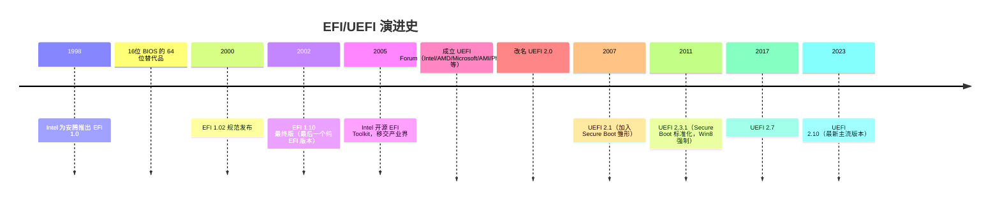

EFI = **Extensible Firmware Interface（可扩展固件接口）**——Intel 在 1998 年为安腾（Itanium）服务器平台原创的固件接口规范，目的是**取代老旧的 BIOS（16 位实模式、寻址 1MB、靠中断向量表干活）**。后来 EFI 发展成行业联盟维护的 **UEFI（Unified Extensible Firmware Interface）**，所以今天**日常语境里 EFI ≈ UEFI，两者基本混用**——但严格说 EFI 是 1.x 版本的旧称，UEFI 是 2.x 以后的新称。

## 一句话定位

> **EFI/UEFI = 介于"操作系统"和"平台固件（BIOS 替代者）"之间的一套接口规范**——它定义了 OS 怎么和固件对话、固件怎么初始化硬件、OS Loader 怎么被加载。

## EFI → UEFI 的来龙去脉



**关键转折**：2005 年 Intel 把 EFI 移交给 UEFI Forum 产业联盟，改名为 UEFI。**所以今天你听到"EFI"和"UEFI"指的是同一套东西**——只是老文档/老人口头还叫 EFI。

## EFI 规范里定义的几大核心概念

### 1️⃣ EFI System Partition（ESP，EFI 系统分区）

主板固件能识别的特殊 FAT32 分区，存放 OS Loader 和 EFI 应用：

```
ESP (通常 100-500MB, GPT 类型 GUID: C12A7328-F81F-11D2-BA4B-00A0C93EC93B)
└── EFI/
    ├── Microsoft/
    │   └── Boot/
    │       ├── bootmgfw.efi       (Windows Boot Manager)
    │       └── BCD                (Boot Config Data)
    ├── ubuntu/
    │   └── grubx64.efi            (GRUB)
    ├── Boot/
    │   └── BOOTX64.EFI            (Fallback 路径)
    └── tools/
        └── Memtest86.efi
```

### 2️⃣ EFI Application（.efi 文件）

符合 EFI 规范的可执行文件（PE32+ 格式，带 EFI 子系统签名）：

- **OS Loader**：`grubx64.efi`、`bootmgfw.efi`
    
- **固件工具**：`shellx64.efi`（UEFI Shell）
    
- **诊断工具**：Memtest86、硬件诊断
    
- **驱动**：DXE 阶段加载的 `.efi` 驱动模块
    

EFI 应用的入口签名：

```c
EFI_STATUS EFIAPI
EntryPoint(
    IN EFI_HANDLE        ImageHandle,
    IN EFI_SYSTEM_TABLE  *SystemTable   // 拿到所有服务
);
```

### 3️⃣ EFI Variables（NVRAM 变量）

存在主板 NVRAM（SPI Flash 的一部分）里的键值对，OS 和固件共享：

```
BootOrder, Boot####        → BDS 阶段用的启动项
ConIn, ConOut, ErrOut      → 控制台设备
SecureBoot, PK, KEK, db, dbx → Secure Boot 密钥
OsIndications              → OS 请求进 Setup 等
```

Linux 下通过 `efivarfs` 挂载查看：

```bash
ls /sys/firmware/efi/efivars/
```

### 4️⃣ EFI Services（四类服务）

|服务类别|生命周期|主要内容|
|---|---|---|
|**Boot Services**​|SEC→TSL（ExitBootServices 前）|内存分配、Protocol、LoadImage/StartImage、事件|
|**Runtime Services**​|永久（含 OS 运行期）|变量读写、时间、复位、虚拟地址映射|
|**EFI Protocol**​|接口集合|Block I/O、GOP、Simple File System 等|
|**EFI Configuration Tables**​|只读表|ACPI、SMBIOS、DXE Services 指针|

## EFI vs 传统 BIOS 的核心差异

|维度|传统 BIOS（Legacy）|EFI/UEFI|
|---|---|---|
|CPU 模式|16 位实模式（1MB 寻址）|32/64 位保护模式/长模式|
|存储寻址|通过 INT 13h CHS/LBA，< 2TB|原生 LBA48，GPT 分区支持 > 2TB|
|启动方式|读 MBR 的 446 字节 bootstrap|从 ESP 加载 `.efi` 应用|
|驱动模型|无，全靠 Option ROM|Protocol 体系，模块化驱动|
|扩展性|几乎无|极强（DXE 驱动可动态加载）|
|安全|无|Secure Boot 签名验证|
|控制台|文本模式 VGA|GOP（Graphics Output Protocol），图形化|
|配置存储|CMOS（有限字节）|NVRAM 变量（KV 数据库）|

## EFI 的启动流程（接你前面七阶段）

```
传统 BIOS 路径：
  上电 → POST → 读 MBR → 跳 bootstrap → 加载 OS Loader → OS

EFI 路径（你前面学的七阶段）：
  上电 → SEC → PEI → DXE → BDS → TSL → RT → AL
         ↑
         EFI 规范的 SEC/PEI/DXE/BDS/TSL/RT/AL 七阶段
```

**EFI 规范 = 定义了这七阶段的行为契约 + Protocol 体系 + 服务接口 + 变量存储格式**。固件厂商（AMI/Award/Insyde）按规范实现，OS 厂商（Microsoft/Apple/Linux）按规范写 OS Loader。

## 容易混淆的"EFI"用法

日常语境里你会看到 EFI 出现在这些地方，**指的其实是不同东西**：

|说法|实际指代|
|---|---|
|"EFI 固件"|主板上的 UEFI 固件实现（如 AMI Aptio、InsydeH2O）|
|"EFI 分区"|EFI System Partition（ESP）|
|"EFI 文件"|.efi 后缀的 EFI 应用/驱动|
|"EFI 启动"|从 ESP 加载 .efi OS Loader 的启动方式（对比 Legacy MBR）|
|"EFI 变量"|NVRAM 里的 EFI 变量|
|"EFI Shell"|UEFI Shell（固件级命令行环境）|
|"EFI 模式"|主板 CSM 关闭、纯 UEFI 模式（对比 Legacy/CMS 模式）|

## 一句收

> **EFI = Extensible Firmware Interface，Intel 1998 年为安腾原创、取代 BIOS 的固件接口规范；2005 年移交 UEFI Forum 后改名 UEFI（Unified EEFI），今天 EFI ≈ UEFI 混用。EFI 规范定义了：① 七阶段启动流程（SEC→PEI→DXE→BDS→TSL→RT→AL）；② EFI System Partition（ESP）存放 .efi 应用；③ EFI Protocol 服务体系（Boot/Runtime/Driver Model）；④ EFI NVRAM 变量（BootOrder/SecureBoot 等）。它把固件从"16 位实模式、INT 中断、MBR bootstrap"的旧世界，升级为"32/64 位保护模式、Protocol 驱动模型、GPT + ESP 加载 OS Loader"的新世界。**

## 接你前面整条线

```
硬件层：ATX → VRM → Vcore → CPU 上电
指令层：Reset Vector → CS:IP → 保护模式 → 长模式
EFI 固件层（你前面学的七阶段）：
  SEC → PEI → DXE → BDS → TSL → RT → AL
  └── 全部由 EFI/UEFI 规范定义行为契约
       ├── EFI System Table / Boot Services / Runtime Services
       ├── EFI Protocol（Block I/O、GOP、Simple File System...）
       ├── EFI NVRAM Variables（BootOrder、SecureBoot...）
       └── EFI Applications（grubx64.efi、bootmgfw.efi、shellx64.efi）
OS 层：通过 EFI Boot Services 加载 OS Loader → ExitBootServices → OS 接管
```

你前面钻的 SEC/PEI/DXE/BDS 全是 **EFI 规范里定义的阶段**——所以"EFI"这个词在你这条学习路径里**不是某个具体阶段，而是统摄所有阶段的规范框架本身**。

要不要顺着把 **"Legacy BIOS 的 16 位 POST 流程 vs UEFI 的七阶段"**​ 做个详细对比？那块能把"为什么 UEFI 取代 BIOS"在指令级/架构级钉死，接你"从 MOS 到 Linux 桌面"的完整闭环。还是想看 **"Secure Boot 在 EFI 规范里的具体实现（PK/KEK/db/dbx 四级密钥链 + 签名验证流程）"**？后者更接安全/可信启动方向，前者更体系结构主线。