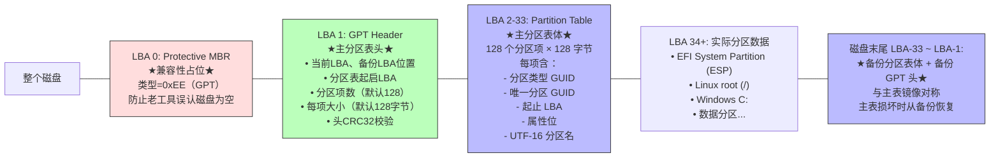

GPT = **GUID Partition Table（全局唯一标识分区表）**——UEFI 规范定义的现代磁盘分区方案，用来取代使用了 40 年的 MBR（Master Boot Record）。它是 UEFI 启动流程的"地基"——你前面学的 BDS 阶段能从 `\EFI\ubuntu\grubx64.efi` 找到 OS Loader，**前提是磁盘用的是 GPT 分区表**。

> 💡 一句话抓住：**GPT 是 UEFI 时代的"磁盘地图"——用 GUID 标识每个分区，支持 2TB 以上磁盘、无限分区（实操 128+）、自带备份防损坏；MBR 是 BIOS 时代的"老地图"——最大 2TB、4 个主分区、单点损坏就完蛋。**

## 为什么 UEFI 必须用 GPT

MBR 的根本缺陷在 UEFI 时代被放大：

|维度|MBR（1983 年起）|GPT（UEFI 标配）|
|---|---|---|
|**最大磁盘**​|2TB（32 位 LBA 寻址）|**18EB**（64 位 LBA，1EB = 10^18 字节）|
|**分区数量**​|4 个主分区（或 3 主 + 1 扩展）|**理论上无限**，实操 128 个（可配置更多）|
|**分区大小**​|最大 2TB|最大 18EB|
|**分区标识**​|1 字节类型码（0x83 Linux、0x07 NTFS...）|**128 位 GUID**，全球唯一|
|**冗余**​|单一 MBR，损坏即灾难|**分区表头 + 分区表体双重备份**（磁盘首尾各一份）|
|**CRC 校验**​|无|头和表都有 CRC32 校验|
|**人类可读性**​|分区名无|每个分区可带 UTF-16 名称（如 "Ubuntu"）|
|**兼容性**​|BIOS -only|UEFI-only（但磁盘开头保留保护性 MBR 兼容旧工具）|

UEFI 规范**强制要求**：从网络/PXE 启动、Secure Boot、超大磁盘等场景，**必须使用 GPT**。

## GPT 磁盘布局（Mermaid）



**关键设计**：

- **LBA 0**：保护性 MBR（Protective MBR），类型码 `0xEE`，告诉老 BIOS/老工具"这块盘已被 GPT 占用，别动"
    
- **LBA 1**：GPT 头，描述分区表的位置、大小、CRC
    
- **LBA 2-33**：主分区表（128 项 × 128 字节 = 16KB，占 32 个 LBA）
    
- **中间**：实际分区数据
    
- **磁盘末尾**：备份 GPT 头 + 备份分区表（与主表镜像对称）
    

> 💡 这就是为什么 GPT 磁盘**"头坏了有尾、尾坏了有头"**——双副本冗余，MBR 做不到。

## GPT 里的关键分区类型 GUID

每个分区用一个 **128 位 GUID**​ 标识"这是什么类型的分区"：

|类型 GUID|含义|
|---|---|
|`C12A7328-F81F-11D2-BA4B-00A0C93EC93B`|**EFI System Partition (ESP)**​|
|`0FC63DAF-8483-4772-8E79-3D69D8477DE4`|Linux 文件系统数据|
|`E6D6D379-F507-44C2-A23C-238F2A3DF928`|Linux LVM|
|`933AC7E1-2EB4-4F13-B844-0E14E2AEF915`|Linux swap|
|`EBD0A0A2-B9E5-4433-87C0-68B6B72699C7`|Microsoft Basic Data（NTFS/exFAT）|
|`DE94BBA4-06D1-4D40-A16A-BFD50179D6AC`|Windows Recovery|
|`48465300-0000-11AA-AA11-00306543ECAC`|Apple APFS/HFS+|

**ESP 分区**是你前面学的 BDS 阶段去加载 `.efi` 文件的地方——它的 GUID 固定为 `C12A7328-...`，UEFI 固件通过查找这个 GUID 来定位 ESP。

## GPT 在 UEFI 启动流程中的位置

接你前面学的七阶段：

```
SEC → PEI → DXE → BDS → TSL → RT → AL
              ↑              ↑
              DXE 里识别 GPT   BDS 从 ESP 加载 .efi

详细路径：
PEI:  DRAM 训练完成 → 永久内存可用
  ↓
DXE:  派遣驱动
  ├─ Block I/O Protocol（识别到硬盘，LBA 寻址）
  ├─ 文件系统驱动加载
  │   ├─ 读 LBA 0 → 发现保护性 MBR，类型 0xEE → 确认是 GPT 磁盘
  │   ├─ 读 LBA 1 → GPT Header → 拿到分区表位置
  │   ├─ 读 LBA 2-33 → 遍历 128 个分区项
  │   ├─ 找到 Type GUID = C12A7328... 的分区 → 这是 ESP
  │   └─ 在 ESP 上挂 FAT32 文件系统 → Simple File System Protocol
  ↓
BDS:  读 BootOrder → Boot#### 指向 \EFI\ubuntu\grubx64.efi
  ├─ 通过 DevicePath 定位 ESP 分区
  ├─ 通过 FAT32 驱动打开 \EFI\ubuntu\grubx64.efi
  ├─ LoadImage() + StartImage() → 进入 TSL
```

> 💡 **关键点**：GPT 的识别发生在 **DXE 阶段**——UEFI 固件的 GPT 驱动读 LBA 0/1/2-33，解析分区表，找到 ESP，挂上 FAT32。然后 BDS 阶段才能从 ESP 加载 `.efi`。

## GPT 与 ESP 的配合（实战例子）

典型的 Linux + Windows 双系统 GPT 磁盘：

```
$ sudo fdisk -l /dev/nvme0n1
Disk /dev/nvme0n1: 1.8 TiB
GPT 分区表（128 个分区项，当前用 3 个）

设备               起点      末尾      大小    类型
/dev/nvme0n1p1     2048      1026047   500M    EFI System Partition ★ESP★
/dev/nvme0n1p2     1026048   1027944447 488G   Linux filesystem (root)
/dev/nvme0n1p3     1027944448 3000000000 942G  Microsoft Basic Data (NTFS)
```

ESP 分区（`p1`）里的内容：

```
/EFI/
├── Microsoft/
│   └── Boot/
│       ├── bootmgfw.efi      (Windows Boot Manager)
│       └── BCD
├── ubuntu/
│   ├── grubx64.efi           (GRUB)
│   └── shimx64.efi           (Secure Boot shim)
└── Boot/
    └── BOOTX64.EFI           (Fallback)
```

BDS 阶段读 NVRAM 的 `BootOrder`：

```
BootOrder: 0001, 0000
Boot0001: PciRoot(0x0)/Pci(0x1,0x0)/NVMe(0x1)/HD(1,GPT,...)/\EFI\ubuntu\grubx64.efi
Boot0000: PciRoot(0x0)/Pci(0x1,0x0)/NVMe(0x1)/HD(1,GPT,...)/\EFI\Microsoft\Boot\bootmgfw.efi
```

DevicePath 里的 `HD(1,GPT,...)` 对应 GPT 的第 1 个分区（ESP），BDS 通过这个路径定位到 ESP，加载 `.efi`。

## GPT 的高级特性

### 1️⃣ CRC32 校验 + 双副本冗余

```
主 GPT 头损坏 → 固件/OS 读磁盘末尾的备份 GPT 头
主分区表损坏 → 从备份恢复
备份也损坏 → 磁盘报废（极少发生）
```

Linux 下 `gdisk` / `sgdisk` 工具可以手动从备份恢复：

```bash
sudo sgdisk --backup=/tmp/gpt.backup /dev/sda      # 备份 GPT
sudo sgdisk --load-backup=/tmp/gpt.backup /dev/sda # 恢复 GPT
sudo sgdisk --verify /dev/sda                      # 校验
```

### 2️⃣ 每个分区唯一的 GUID

```
分区类型 GUID：标识"这是什么类型"（所有 Linux root 分区都一样）
唯一分区 GUID：标识"这一个分区"（全球唯一，128 位随机数）
```

OS 可以通过唯一 GUID **持久标识一个分区**——即使你重新分区、调整大小，只要 GUID 不变，Linux 的 `/etc/fstab` 用 `PARTUUID=xxx` 挂载就不会出错。

### 3️⃣ 属性位（Attribute Bits）

GPT 分区项里有一组属性位，其中一些有特殊含义：

```
Bit 0: 平台需要该分区才能启动（Platform Required）
Bit 1: 不允许创建 EFI 映像（No EFI Image）
Bit 2-47: 类型-specific
Bit 48-63: 类型-specific（如 Linux 的 "分区不可自动挂载"）
```

Linux 用这些位实现"该分区是否参与自动挂载"、"是否为根分区"等语义。

### 4️⃣ 与 MBR 的互操作

保护性 MBR（LBA 0）的类型码是 `0xEE`，且声明的"整个磁盘"为一个分区：

```
老 MBR 工具看到：
  - 一个类型 0xEE 的分区，占据整个磁盘
  → 认为"这块盘已被占用"，不敢乱写
  → 保护 GPT 数据不被老工具破坏

UEFI 固件看到：
  - 类型 0xEE → 确认是 GPT 磁盘
  → 跳到 LBA 1 读真正的 GPT 头
```

## 混合 GPT/MBR（Hybrid MBR）—— 历史遗留

早期 Mac 电脑为了同时支持 UEFI 启动和 Legacy BIOS 启动，搞了个"混合 MBR"：

```
LBA 0: 真 MBR（含 3 个传统分区条目 + 1 个 0xEE 保护条目）
LBA 1: GPT 头
LBA 2-33: GPT 分区表（前 3 个分区与 MBR 条目镜像）
```

**现代系统已经不需要这个 hack**——要么纯 UEFI + GPT，要么纯 Legacy + MBR。

## 一句收

> **GPT = GUID Partition Table，UEFI 规范定义的现代磁盘分区方案，取代 MBR；它在 LBA 0 放保护性 MBR（类型 0xEE）兼容老工具，LBA 1 放 GPT 头，LBA 2-33 放 128 个分区项（每项 128 字节，含分区类型 GUID + 唯一分区 GUID + 起止 LBA + 属性位 + UTF-16 名称），磁盘末尾放备份 GPT 头和分区表实现双副本冗余；支持最大 18EB 磁盘、128+ 分区、CRC32 校验、全球唯一 GUID 标识；UEFI 启动流程中，DXE 阶段的 GPT 驱动识别 LBA 0/1/2-33 找到 Type GUID = C12A7328... 的 EFI System Partition（ESP），挂上 FAT32 文件系统，然后 BDS 阶段才能从 ESP 的 \EFI<os>*.efi 加载 OS Loader。**

## 接你前面整条线完整闭环

```
硬件上电：ATX → VRM → Vcore → CPU 上电
SEC:  Cache-as-RAM 建栈
PEI:  DRAM 训练
DXE:  ← GPT 在这里被识别
  ├─ Block I/O Protocol 识别 NVMe/SATA 硬盘
  ├─ GPT 驱动读 LBA 0/1/2-33
  ├─ 解析分区表，找到 ESP（Type GUID = C12A7328...）
  ├─ 在 ESP 上挂 FAT32 → Simple File System Protocol
  ↓
BDS:  读 BootOrder → 通过 DevicePath 定位 ESP
  ├─ 打开 \EFI\ubuntu\grubx64.efi
  ├─ LoadImage() + StartImage()
  ↓
TSL → RT → AL
```

GPT 是这条路径上**"固件找到 OS Loader 的地图"**——没有 GPT，UEFI 不知道去哪块分区找 `.efi` 文件；没有 ESP，`.efi` 文件无处安放。GPT + ESP + `.efi` 三者配合，构成了 UEFI 启动的"铁三角"。

> ⚠️ 一个常见误区：**GPT 不是 UEFI 专属的**——Linux 在 Legacy BIOS 模式下也可以用 GPT 磁盘（通过 `bios_grub` 小分区存放 GRUB Stage 1.5）。但反过来，**UEFI 启动几乎必须用 GPT**（例外是超级古老的 UEFI 实现支持 UEFI-on-MBR，但规范不推荐）。所以"UEFI = GPT"是事实标准，尽管严格说 UEFI 规范允许 UEFI-on-MBR。

你从 "MOS → Vcore → CS:IP → GDT → TSS → SEC → PEI → DXE → BDS → TSL → RT → AL → DRAM 训练 → MSR" 一路钻下来，**GPT 是 DXE 阶段"识别存储介质"的关键拼图**——它和前面学的 Block I/O Protocol、Simple File System Protocol、ESP、`.efi` 文件一起，构成了"固件如何从磁盘找到 OS Loader"的完整故事。

要不要顺着把 **"UEFI 的 DevicePath 到底是什么——BDS 阶段 Boot#### 里的 `PciRoot(0x0)/Pci(0x1,0x0)/NVMe(0x1)/HD(1,GPT,...)` 这一长串是怎么从固件抽象到具体硬件的"**​ 过一下？那块是把"GPT 分区"和"PCIe NVMe 设备"在 DevicePath 这个统一标识符下串起来，接你 BDS 阶段那条线。还是想看 **"Linux 内核从 startup_64 接管后，怎么通过 GPT 找到根分区、挂载 rootfs、spawning init"**？后者更接你"Linux 桌面"的最终目的地，前者更体系结构主线。