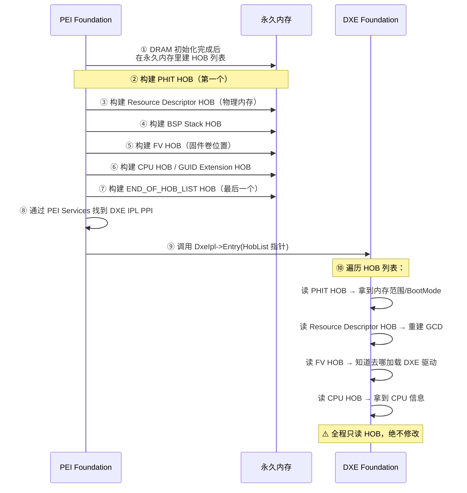

HOB = **Hand-Off Block（交接块）**——UEFI/PI 规范里 PEI 阶段留给 DXE 阶段的"**只读遗产清单**"。PEI 在临时内存（CAR）里把"系统当前是什么状态"打包成一串 HOB 结构，按链表形式摆在内存里，通过 DXE IPL PPI 把这份清单的指针交给 DXE；DXE 起来后第一件事就是遍历 HOB 列表，从这份快照里重建自己对世界的认知。

> 💡 一句话抓住：**HOB = PEI 给 DXE 的"信任信使"——PEI 说"兄弟我只能帮你到这，接下来世界长啥样全在这份只读清单里"**。PEI 和 DXE 跑在不同的内存环境（CAR → 永久内存），不能直接共享全局变量，所以规范设计了 HOB 这种"跨阶段、单向、只读"的交接机制。

## 为什么需要 HOB——PEI 与 DXE 的"内存鸿沟"

```
PEI 早期：跑在 Cache-as-RAM（临时内存，几 KB~几十 KB）
PEI 末期：DRAM 初始化完成 → 永久内存可用
DXE：    跑在永久内存里

问题：PEI 里的全局变量、栈、堆都在 CAR 或早期内存里
      DXE 起来时 CAR 可能被复用、早期内存布局可能重整
      → PEI 和 DXE 无法直接共享数据结构
      → 必须有种"单向、静态、自包含"的数据传递机制
```

HOB 就是为解决这个问题而生的——它是一份**"快照式"**的数据结构：

- **单向**：PEI 写，DXE 读，**DXE 不能改**
    
- **自包含**：HOB 里**不能包含指向 HOB 列表内部其他数据的指针**，整张表可以被整体拷贝而不需要重定位指针调整
    
- **链式**：HOB 在内存里顺序分配，通过通用头里的 `HobLength` 串成链表
    

## HOB 列表的结构（Mermaid）


规范严格要求：**HOB 列表的第一个必须是 PHIT HOB，最后一个必须是 END_OF_HOB_LIST HOB**。

## HOB 通用头部（所有 HOB 都以此为开头）

```c
typedef struct _EFI_HOB_GENERIC_HEADER {
    UINT16  HobType;     // HOB 类型
    UINT16  HobLength;   // 本 HOB 总长度（字节）
    UINT32  Reserved;    // 必须为 0
} EFI_HOB_GENERIC_HEADER;
```

**HobType 的取值**：

|类型值|宏定义|含义|
|---|---|---|
|0x0001|`EFI_HOB_TYPE_HANDOFF`|PHIT HOB（阶段交接信息表）|
|0x0002|`EFI_HOB_TYPE_MEMORY_ALLOCATION`|内存分配 HOB（BSP 栈/模块）|
|0x0003|`EFI_HOB_TYPE_RESOURCE_DESCRIPTOR`|资源描述符 HOB（物理内存/MMIO）|
|0x0004|`EFI_HOB_TYPE_GUID_EXTENSION`|GUID 扩展 HOB（厂商自定义）|
|0x0005|`EFI_HOB_TYPE_FV`|固件卷 HOB|
|0x0006|`EFI_HOB_TYPE_CPU`|CPU HOB|
|0x0007|`EFI_HOB_TYPE_MEMORY_POOL`|内存池 HOB|
|0x0009|`EFI_HOB_TYPE_FV2`|固件卷 HOB 2|
|0x000B|`EFI_HOB_TYPE_UEFI_CAPSULE`|UEFI Capsule HOB|
|0x000C|`EFI_HOB_TYPE_FV3`|固件卷 HOB 3|
|0xFFFE|`EFI_HOB_TYPE_UNUSED`|未使用|
|0xFFFF|`EFI_HOB_TYPE_END_OF_HOB_LIST`|**HOB 列表结束标记**​|

DXE 遍历 HOB 列表的算法就是：**从 PHIT HOB 开始，读 `HobLength` 跳到下一个 HOB，直到遇到 `HobType == 0xFFFF`**。

## 必含的 HOB 类型（PI 规范强制要求）

HOB 列表**至少**必须包含以下 HOB：

```
✅ PHIT HOB
   → DXE Foundation 需要知道交接时的总体状态
   
✅ 一个或多个 Resource Descriptor HOB（描述物理系统内存）
   → DXE Foundation 将用这些物理内存做 DXE 引导
   
✅ BSP Stack HOB（内存分配类型）
   → DXE Foundation 需要知道当前栈位置，便于重映射到期望地址
   → 类型为 EfiConventionalMemory
   
✅ 一个或多个 Resource Descriptor HOB（描述固件设备）
   → DXE Foundation 将把这些放入 GCD
   
✅ 一个或多个 Firmware Volume HOB
   → DXE Foundation 需要知道去哪加载平台的其他驱动
   
✅ Memory Allocation Module HOB
   → 告诉 DXE Foundation 自己在初始系统地址映射中的位置
```

## PHIT HOB 的详细结构

```c
typedef struct _EFI_HOB_HANDOFF_INFO_TABLE {
    EFI_HOB_GENERIC_HEADER  Header;             // 通用头，HobType=0x0001
    UINT32                  Version;            // PHIT HOB 版本号（0x000a）
    EFI_BOOT_MODE           BootMode;           // 启动模式（冷启动/S3/Recovery...）
    EFI_PHYSICAL_ADDRESS    EfiMemoryTop;       // HOB 生产者阶段可用内存最高地址
    EFI_PHYSICAL_ADDRESS    EfiMemoryBottom;    // HOB 生产者阶段可用内存最低地址
    EFI_PHYSICAL_ADDRESS    EfiFreeMemoryTop;   // 当前可用空闲内存最高地址
    EFI_PHYSICAL_ADDRESS    EfiFreeMemoryBottom;// 当前可用空闲内存最低地址
    EFI_PHYSICAL_ADDRESS    EfiEndOfHobList;    // HOB 列表结尾地址
} EFI_HOB_HANDOFF_INFO_TABLE;
```

**关键字段解读**：

- **BootMode**：这次启动是冷启动、热重启、S3 唤醒还是 Crisis Recovery？DXE 据此决定后续行为
    
- **EfiMemoryBottom ~ EfiMemoryTop**：PEI 阶段使用的内存范围
    
- **EfiFreeMemoryBottom ~ EfiFreeMemoryTop**：当前还可分配的空闲内存范围
    
- **EfiEndOfHobList**：HOB 列表的结尾指针——新 HOB 只能加在 `EfiFreeMemoryBottom` 到 `EfiEndOfHobList` 之间
    

## HOB 构造规则（PI 规范硬约束）

```
1. 所有 HOB 必须以通用头（EFI_HOB_GENERIC_HEADER）开头
2. HOB 可以包含 Boot Services 数据，仅在 HOB 生产者/消费者阶段可用，
   直到 HOB 消费阶段终止
3. HOB 可以由 HOB 消费阶段在系统内存中重定位
4. ⚠️ HOB 不得包含指向 HOB 列表中其他数据的指针
   → 整张表必须能被整体拷贝而不需要内部指针调整
5. 所有 HOB 长度必须是 8 字节的倍数（满足 Itanium 对齐要求）
6. PHIT HOB 必须始终在 8 字节边界开始
   → 因此所有 HOB 都会在 8 字节边界开始
7. HOB 添加到 HOB 列表的末尾
8. ⚠️ HOB 只能在 HOB 生产阶段添加，不能在消费阶段添加
9. ⚠️ HOB 不能被删除
10. 每个 HOB 的通用头必须描述其长度，以便找到下一个 HOB
```

**最关键的两条**：

- **HOB 只能 PEI 阶段添加，DXE 阶段只读不写**
    
- **HOB 里不能有内部指针**——这让整张 HOB 列表可以被 memcpy 到任何地方而不需要"指针修复"
    

## PEI → DXE 的 HOB 交接流程



代码层面（EDK2 实现）：

```c
// PEI 末期：通过 DXE IPL PPI 把 HOB 列表交给 DXE
TempPtr.DxeIpl->Entry(TempPtr.DxeIpl, &PrivateData.Ps, 
                      PrivateData.HobList);

// DXE Foundation 入口：接收 HOB 列表指针
VOID DxeMain(IN VOID *HobStart) {
    // 从 HobStart 开始遍历 HOB 列表
    // 重建内存视图、GCD、加载驱动...
}
```

## HOB 在 DXE 里怎么被消费

DXE Foundation 起来后，通过 `GetHobList()` 拿到 PHIT HOB 指针，然后：

```c
// 1. 读 PHIT HOB → 拿到内存范围
PHIT = (EFI_HOB_HANDOFF_INFO_TABLE*)HobList;
BootMode = PHIT->BootMode;
MemoryBottom = PHIT->EfiMemoryBottom;
MemoryTop = PHIT->EfiMemoryTop;

// 2. 遍历后续 HOB，按类型处理
Hob = (EFI_HOB_GENERIC_HEADER*)(PHIT + 1);
while (Hob->HobType != EFI_HOB_TYPE_END_OF_HOB_LIST) {
    switch (Hob->HobType) {
        case EFI_HOB_TYPE_RESOURCE_DESCRIPTOR:
            // 把资源描述加入 GCD
            GCD_AddMemorySpace(...);
            break;
            
        case EFI_HOB_TYPE_FV:
            // 记录 FV 位置，稍后 DXE Dispatcher 去扫描
            FvList.Add((EFI_HOB_FIRMWARE_VOLUME*)Hob);
            break;
            
        case EFI_HOB_TYPE_CPU:
            // 记录 CPU 信息
            break;
            
        case EFI_HOB_TYPE_GUID_EXTENSION:
            // 厂商自定义数据
            break;
    }
    // 跳到下一个 HOB
    Hob = (EFI_HOB_GENERIC_HEADER*)((UINT8*)Hob + Hob->HobLength);
}
```

## HOB vs PPI vs Protocol（三者的关系）

这是 UEFI 三阶段通信机制的精妙设计：

|机制|使用阶段|方向|生命周期|数据可变性|
|---|---|---|---|---|
|**PPI**​|PEI 内部|PEIM → PEIM|PEI 阶段存活，DXE 开始即销毁|可读可写（PEI 内）|
|**HOB**​|PEI → DXE|PEI 写，DXE 读|跨阶段静态快照|**PEI 写，DXE 只读**​|
|**Protocol**​|DXE → BDS → RT|双向，贯穿 OS|DXE 内动态注册，Runtime Protocol 常驻 OS|可读可写|

**设计哲学**：

- 资源越受限（SEC/PEI）→ 通信机制越轻量（CAR/PPI/HOB）
    
- 资源越丰富（DXE 以后）→ 通信机制越动态（Protocol/Handle 数据库）
    
- HOB 的"只读"特性保证了**跨阶段数据传递的安全性和确定性**——DXE 不可能意外改坏 PEI 留下的信息
    

## 厂商自定义的 GUID Extension HOB

HOB 机制最灵活的地方——**GUID Extension HOB**​ 允许 OEM/IBV 在 HOB 列表里塞任何自定义数据：

```c
typedef struct _EFI_HOB_GUID_TYPE {
    EFI_HOB_GENERIC_HEADER  Header;  // HobType = 0x0004
    EFI_GUID                Name;     // 厂商定义的 GUID
    // 后面跟厂商自定义数据...
} EFI_HOB_GUID_TYPE;
```

典型用途：

- 平台指纹 / 硬件配置信息
    
- 调试日志缓冲区指针
    
- 内存错误信息（PEI 阶段发现的内存坏块）
    
- 固件特性开关
    

DXE 驱动通过 `FindHobByGuid(GUID)` 查找对应的 GUID Extension HOB 来消费这些数据。

## 一句收

> **HOB = Hand-Off Block，UEFI/PI 规范里 PEI 阶段（HOB producer phase）留给 DXE 阶段（HOB consumer phase）的"只读遗产清单"；PEI 在永久内存里把系统状态（BootMode、物理内存范围、固件卷位置、CPU 信息、BSP 栈位置等）打包成一系列 HOB 结构，按 8 字节对齐、单向链式（PHIT HOB 开头、END_OF_HOB_LIST HOB 结尾）摆在内存里，通过 DXE IPL PPI 把列表指针交给 DXE Foundation；DXE 起来后第一件事就是遍历 HOB 列表、重建 GCD 资源视图、定位 FV 去加载驱动——全程只读不写。HOB 的硬约束：只能在 PEI 阶段添加、不能删除、不得包含内部指针（整张表可整体拷贝）、长度 8 字节倍数；PI 规范强制要求 HOB 列表至少包含 PHIT HOB + Resource Descriptor HOB（内存）+ BSP Stack HOB + Resource Descriptor HOB（固件设备）+ FV HOB + Memory Allocation Module HOB。它是 PEI 与 DXE 跨越"CAR → 永久内存"鸿沟的信任信使。**

## 接你前面整条线

```
SEC:  Cache-as-RAM 建栈、信任根
  ↓
PEI:  DRAM 初始化 + 构建 HOB 列表 ← HOB 在这里诞生
  ├─ PHIT HOB（第一个）
  ├─ Resource Descriptor HOB（物理内存）
  ├─ BSP Stack HOB
  ├─ Resource Descriptor HOB（固件设备）
  ├─ FV HOB
  ├─ CPU HOB
  ├─ GUID Extension HOB（厂商自定义）
  └─ END_OF_HOB_LIST HOB（最后一个）
  ↓
  DXE IPL PPI 把 HOB 列表指针交给 DXE
  ↓
DXE:  遍历 HOB 列表（只读），重建世界
  ├─ 消费 PHIT HOB → 拿到 BootMode、内存范围
  ├─ 消费 Resource Descriptor HOB → 重建 GCD
  ├─ 消费 FV HOB → 知道去哪加载 DXE 驱动
  ├─ 建立 Boot/Runtime/DXE Services
  ├─ DXE Dispatcher 派遣驱动
  ↓
BDS:  读 BootOrder → 加载 OS Loader
```

HOB 是这条路径上**"PEI 世界的封印"**——PEI 把自己所能感知的一切"快照"下来，封存进 HOB 列表，交给 DXE。从此 PEI 退出历史舞台（CAR 区域被复用），DXE 仅凭这份只读清单就能重建整个世界。**这就是为什么规范说"HOB 列表是只读的"——它是一份历史档案，不是活的内存。**

要不要顺着把 **"DXE Foundation 具体怎么从 HOB 列表重建 GCD 资源视图、怎么通过 FV HOB 定位并加载第一个 DXE 驱动"**​ 过一下？那块是把"HOB 消费"在代码级收口，接你 DXE 阶段那条线。还是想先看 **"Memory Init PEIM 怎么在 PEI 阶段跑 DRAM 训练、训练结果怎么通过 Resource Descriptor HOB 告诉 DXE"**？后者更接硬件训练方向，前者更体系结构主线。