UEFI/PI 规范把"开机到 OS 接管"切成 **7 个阶段**：

```
SEC → PEI → DXE → BDS → TSL → RT → AL
```

前 3 个是**固件初始化**（到 DXE 结束 UEFI 环境就绪），BDS+TSL 是**装载 OS Loader**，RT+AL 是**OS 运行期 UEFI 仍在场**。下面按时间顺序细拆，每个阶段讲清"谁在跑、内存/服务状态、主要产物、交给下一阶段什么"。

---

## 阶段总览（先有一张全景图）

| 阶段           | 全称                                   | 主存可用？              | 执行环境                 | 一句话使命                            |
| ------------ | ------------------------------------ | ------------------ | -------------------- | -------------------------------- |
| **[[SEC]]**​ | Security Phase(安全阶段)                 | ❌ 无（用 Cache 当 RAM） | 纯汇编 → C              | 建立临时栈、信任根                        |
| **[[PEI]]**​ | Pre-EFI Initialization(EFI初始化阶段)     | ❌→✅ 后期才有           | C + PEIM             | 初始化 DRAM、建 [[HOB]]               |
| **[[DXE]]**​ | Driver Execution Environment(驱动执行阶段) | ✅ 完整               | C + DXE 驱动           | 加载驱动、建 Boot/Runtime 服务           |
| **[[BDS]]**​ | Boot Device Selection(启动设备选择阶段)      | ✅                  | DXE 驱动               | 选启动项、加载 OS Loader                |
| **[[TSL]]**​ | Transient System Load(临时系统加载阶段)      | ✅                  | OS Loader 作为 UEFI 应用 | OS Loader 执行到 ExitBootServices() |
| **[[RT]]**​  | Runtime(运行时阶段)                       | ✅                  | OS 内核                | Runtime Services 常驻              |
| **[[AL]]**​  | After-Life()                         | —                  | 固件                   | 灾难恢复                             |

---

## 1️⃣ SEC（Security Phase）—— 信任根 + 临时栈

**入口**：CPU Reset 后执行的第一段代码（x86 上从 Reset Vector `0xFFFFFFF0` 取指）。

**四大职责**：

1. **接收/处理所有重启信号**：[[冷启动、热重启]]、S3 唤醒
    
2. **Cache-as-RAM（CAR）**：此时 DRAM 未初始化，把 L1 Cache 配成 no-eviction 模式当临时 RAM，建立栈 → C 语言环境可用
    
3. **信任根（Root of Trust）**：验证后续 PEI Core 的完整性（配合 Intel Boot Guard / AMD PSP）
    
4. **传递参数给 PEI**：通过 `EFI_SEC_PEI_HAND_OFF` 结构体把"临时 RAM 地址/大小、栈地址/大小、BFV 位置"交给 PEI
    

**出口**：调用 `PeiCoreEntry()`，控制权永久移交 PEI。

> 💡 SEC 是 UEFI 七阶段里**最依赖 CPU 架构**的阶段——x86 用 CAR 技巧，ARM 大多用片上 SRAM。

---

## 2️⃣ PEI（Pre-EFI Initialization）—— 把 DRAM 跑起来 + 建 HOB

**入口**：SEC 跳入 `PeiCore()`。

**资源状态**：早期**仍然在 CAR（临时 RAM）里跑**，称为 **Pre-Memory PEI**；DRAM 初始化完成后 PEI Core 重新加载到永久内存，称为 **Post-Memory PEI**，性能飞跃。

**核心机制**：

- **PEI Foundation**：微型内核，维护 PEI Services Table
    
- **PEIM（Pre-EFI Initialization Module）**：一个个独立功能模块，按 DEPEX（依赖表达式）派遣
    
    - CPU PEIM：微码更新、早期 CPU 配置
        
    - Memory Init PEIM：**最关键**，内存控制器初始化 + DRAM training
        
    - Chipset PEIM：早期芯片组配置
        
    
- **PPI（PEIM-to-PEIM Interface）**：PEI 阶段**内部**模块间通信机制，通过 GUID + 函数指针，由 PEI Foundation 维护数据库
    

**核心产物 —— HOB 列表**：

HOB（Hand-Off Block）= PEI 留给 DXE 的"遗产清单"，是**一段连续内存里的只读链表**：

```
HOB List:
  [PHIT HOB]          必需，HOB 列表头
  [Resource Descriptor HOB]  物理内存范围描述
  [FIRMWARE VOLUME HOB]      FV 位置（DXE 去哪找驱动）
  [Memory Allocation HOB]    栈/BSP 位置
  [GUID Extension HOB]       厂商自定义数据
  [END HOB]                  必需，HOB 列表尾
```

**关键约束**：HOB 列表一旦传给 DXE 就**只读**，DXE 不能改。

**出口**：PEI Foundation 定位 **DXE IPL PPI**（DXE Initial Program Load），通过它把 HOB 列表指针传给 DXE Foundation，跳入 DXE 入口。IA-32 此时必须处于 32-bit 平坦模式。

> 💡 **PPI vs HOB 的区别**（这是 PEI 内部最容易混的）：
> 
> - **PPI**：PEI 内部即时用，DXE 一开始 PPI 数据库就销毁
>     
> - **HOB**：PEI → DXE 的跨阶段交接，DXE 只读
>     

---

## 3️⃣ DXE（Driver Execution Environment）—— UEFI 的"小型操作系统"

**入口**：DXE Foundation 从 HOB 列表里重建系统视图。

**资源状态**：✅ **永久内存完全可用**，可以加载大量驱动。

**DXE Foundation 干的事**：

1. **消费 HOB 列表**：拿到内存布局、FV 位置、BSP 栈
    
2. **初始化 Boot Services + Runtime Services + DXE Services**
    
3. **DXE Dispatcher**：扫描 FV 里的 DXE 驱动，按 DEPEX 依赖派遣执行
    
4. **Global Coherency Domain (GCD)**：动态管理内存/IO 资源
    

**两类 DXE 驱动**：

|类型|何时跑|干什么|
|---|---|---|
|**Early DXE Drivers**​|DXE 早期|产生"DXE Architectural Protocols"，让 Boot/Runtime Services 完整可用|
|**UEFI Driver Model Drivers**​|延迟到 BDS 才真正绑定设备|注册 `Driver Binding Protocol`，不主动碰硬件|

**核心产物 —— Protocol**：

Protocol 是 DXE 阶段的"生产者-消费者"接口（类比 PEI 的 PPI，但是双向、可贯穿到 OS）：

```
Block I/O Protocol     → 块设备抽象（硬盘/USB 盘）
Graphics Output Protocol → 显卡输出
Simple Text Input/Output → 控制台
Loaded Image Protocol  → 已加载镜像
```

驱动通过 `InstallProtocolInterface()` 注册，消费者通过 `LocateProtocol()` 获取。

**出口**：所有 Early DXE 驱动派遣完、Architectural Protocols 齐了 → 通过 **BDS Architectural Protocol**​ 进入 BDS 阶段。

> 💡 DXE 结束时，系统已经是一个功能完备的"小型操作系统"——PCI 枚举完、USB 起来了、ACPI 表建好了、控制台可用了。

---

## 4️⃣ BDS（Boot Device Selection）—— 选启动项 + 加载 OS Loader

**BDS 是作为一个 DXE 驱动执行的**，通过 BDS Architectural Protocol 触发。

**主要工作**：

1. **初始化控制台**：根据 NVRAM 变量 `ConIn`/`ConOut`/`ErrOut`，Connect 对应驱动 → 文本/图形控制台可用
    
2. **枚举启动项**：读 NVRAM 里的 `BootOrder`（启动顺序）和 `Boot####`（每个启动项的详情：设备路径 + EFI 文件路径）
    
3. **连接启动设备**：
    
    - 块设备上的 FAT 文件系统（ESP 分区）
        
    - 网络启动（PXE）
        
    - 兼容的 Option ROM
        
    
4. **执行启动策略**：
    
    - 如果设置了 `BootNext` → 只启动它一次（用后删除）
        
    - 如果超时（`Timeout` 变量）归零 → 自动启动 `BootOrder` 第一项
        
    - 否则 → 显示启动菜单让用户选
        
    

**典型路径**（以 Linux 为例）：

```
BootOrder = [Boot0001, Boot0002, Boot0000]
  ↓ 按顺序尝试
Boot0001:
  设备路径 = HD(1,GPT,...)/\EFI\ubuntu\grubx64.efi
  → 通过 FAT 文件系统的 Load File Protocol 找到 grubx64.efi
  → LoadImage() + StartImage() 加载并执行
  → 进入 TSL 阶段
```

> 💡 如果 `Boot####` 全无 → 固件默认扫 ESP 找 `\EFI\BOOT\BOOTX64.EFI`（x86-64 Fallback 路径）。

---

## 5️⃣ TSL（Transient System Load）—— OS Loader 作为 UEFI 应用执行

**BDS 通过 `StartImage()` 启动 OS Loader（如 `grubx64.efi`），进入 TSL**。

**特点**：

- OS Loader **仍然是一个 UEFI 应用程序**，运行在 UEFI 内核控制下
    
- 可以使用所有 **Boot Services**（内存分配、Protocol 查找、文件读写等）
    
- 可以调用 `ExitBootServices()` 向 RT 阶段过渡
    
- 此时如果 OS Loader 崩溃，可以回到 UEFI Shell 或重启
    

**关键节点**：OS Loader 调用 `ExitBootServices()` → Boot Services 全部失效，系统进入 RT 阶段。

---

## 6️⃣ RT（Runtime Phase）—— OS 运行期，UEFI Runtime Services 常驻

**入口**：`ExitBootServices()` 调用完成。

**资源状态**：

- OS Loader/OS 内核**完全掌控系统**
    
- **Boot Services 全部回收**（内存分配、Protocol 查找等不再可用）
    
- **Runtime Services 常驻**：OS 和 OS Loader 可以继续调用
    
    - 时间/日期服务
        
    - 变量服务（读/写 NVRAM 变量）
        
    - 固件配置接口
        
    - 系统重置
        
    

**Runtime Services 的特殊性**：它们在 `ExitBootServices()` 之前被 UEFI 映射到一个**虚拟地址**，OS 接管后通过 `SetVirtualAddressMap()` 重新映射，所以 OS 运行期仍能调用。

> ⚠️ 一旦进入 RT，如果系统发生灾难性错误且 UEFI 服务无法处理 → 触发 AL 阶段。

---

## 7️⃣ AL（After-Life）—— 灾难恢复

**触发**：RT 阶段遇到灾难性错误时。

**职责**：

- 提供错误处理和灾难恢复机制
    
- 具体方案由厂商自定义（UEFI 规范未硬性规定）
    
- 典型动作：
    
    - 系统复位
        
    - S3 唤醒路径
        
    - 固件恢复（Crisis Recovery）
        
    - 错误日志记录到 CMOS/NVRAM
        
    

---

## 完整数据流（Mermaid 串联）

```mermaid
graph TD
    PWR[上电/复位] --> SEC
    
    subgraph SEC_phase["SEC 阶段（CAR 临时栈）"]
        S1[Reset Vector 纯汇编] --> S2[Cache-as-RAM 建栈]
        S2 --> S3[信任根验证 PEI Core]
        S3 --> S4["填充 EFI_SEC_PEI_HAND_OFF<br/>调 PeiCoreEntry()"]
    end
    
    SEC --> PEI
    
    subgraph PEI_phase["PEI 阶段（临时RAM→永久内存）"]
        P1["PEI Foundation 派遣 PEIM"] --> P2["PPI 内部通信"]
        P2 --> P3["Memory Init PEIM 初始化 DRAM"]
        P3 --> P4["Post-Memory PEI 重入"]
        P4 --> P5["构建 HOB 链表"]
        P5 --> P6["定位 DXE IPL PPI<br/>跳入 DXE Foundation"]
    end
    
    PEI --> DXE
    
    subgraph DXE_phase["DXE 阶段（永久内存完全可用）"]
        D1["消费 HOB 列表"] --> D2["初始化 Boot/Runtime/DXE Services"]
        D2 --> D3["DXE Dispatcher 按 DEPEX 派遣驱动"]
        D3 --> D4["Early 驱动产生 Architectural Protocols"]
        D4 --> D5["UEFI Driver Model 驱动注册 Driver Binding"]
        D5 --> D6["安装 Protocol 到 Handle 数据库"]
        D6 --> D7["触发 BDS Architectural Protocol"]
    end
    
    DXE --> BDS
    
    subgraph BDS_phase["BDS 阶段（DXE 驱动执行）"]
        B1["读 NVRAM: BootOrder/Boot####"] --> B2["初始化控制台 ConIn/ConOut"]
        B2 --> B3["枚举启动设备"]
        B3 --> B4["LoadImage() + StartImage()<br/>加载 OS Loader"]
    end
    
    BDS --> TSL
    
    subgraph TSL_phase["TSL 阶段（OS Loader 作为 UEFI 应用）"]
        T1["OS Loader 运行<br/>可用 Boot Services"] --> T2["准备内核+initramfs"]
        T2 --> T3["调用 ExitBootServices()"]
    end
    
    TSL --> RT
    
    subgraph RT_phase["RT 阶段（OS 运行期）"]
        R1["Boot Services 失效"] --> R2["Runtime Services 常驻"]
        R2 --> R3["OS 内核完全掌控"]
    end
    
    RT -.灾难性错误.-> AL
    
    subgraph AL_phase["AL 阶段（灾难恢复）"]
        A1["错误处理"] --> A2["厂商自定义恢复<br/>复位/S3/Recovery"]
    end
    
    style SEC fill:#f9f,stroke:#333
    style PEI fill:#bbf,stroke:#333
    style DXE fill:#bfb,stroke:#333
    style BDS fill:#ffb,stroke:#333
    style TSL fill:#fbb,stroke:#333
    style RT fill:#bff,stroke:#333
    style AL fill:#ddd,stroke:#333
```



---

## 三件"跨阶段交接"的关键数据结构

这是 UEFI 七阶段最精妙的设计——**每个阶段用不同的"信件"把信息交给下一阶段**：

|数据结构|使用阶段|生命周期|读写性|
|---|---|---|---|
|**PPI**​|PEI 内部|PEI 阶段存活，DXE 开始即销毁|可读可写（PEI 内）|
|**HOB**​|PEI → DXE|PEI 创建，DXE 消费|PEI 写、DXE **只读**|
|**Protocol**​|DXE → BDS → RT|可贯穿到 OS（Runtime Protocol）|可读可写|

**设计哲学**：

- 资源越受限（SEC/PEI）→ 通信机制越轻量（CAR/PPI/HOB）
    
- 资源越丰富（DXE 以后）→ 通信机制越动态（Protocol/Handle 数据库）
    

---

## 接你前面整条线完整闭环

把前面所有知识点串起来，从"硅上电"到"Linux 桌面"的完整路径：

```
硬件层：
  ATX 12V → VRM → Vcore (~1V) → CPU 拿到电

指令层：
  Reset Vector → CS:IP (x86: 0xFFFFFFF0) → 取第一条指令
  → 保护模式切换 → GDT 建立 → 段机制
  → 开 64-bit 长模式

固件层（UEFI 七阶段）：
  SEC:  Cache-as-RAM 建栈、信任根
  PEI:  DRAM 初始化、HOB 列表
  DXE:  PCI 枚举、USB 初始化、ACPI 表构建、Protocol 安装
  BDS:  读 BootOrder、加载 \EFI\ubuntu\grubx64.efi
  TSL:  grub 执行、加载 vmlinuz + initramfs
  RT:   ExitBootServices() → Linux 内核接管
  AL:   灾难恢复备用

OS 层：
  Linux 内核 → 解压 → 启动 init → systemd → 桌面

运行时：
  Runtime Services 常驻（变量/时间/复位）
  分支预测、超标量、Cache 层次、Vcore DVFS 全程在工作
```

你前面钻的每一个概念都有明确位置：

- **MOS/Vcore/VRM**​ → 硬件上电层
    
- **CS:IP/GDT/TSS/SS:ESP**​ → SEC 早期建立
    
- **ACPI 表**​ → DXE 阶段构建，OS 启动后一直在用
    
- **Cache/分支预测/IPC**​ → RT 阶段 OS 运行期 CPU 微架构在工作
    
- **VIBE（AI 编程）**​ → 完全在 OS 之上的应用层
    

---

## 一句收 + 记忆锚点

> **UEFI 七阶段 SEC→PEI→DXE→BDS→TSL→RT→AL，本质是"资源从裸到富、控制权从固件到 OS"的渐进移交**：SEC 用 CAR 建信任根、PEI 用 HOB 交硬件清单、DXE 用 Protocol 建服务世界、BDS 用 NVRAM BootOrder 选 OS Loader、TSL 里 OS Loader 作为 UEFI 应用跑到 ExitBootServices()、RT 里 Runtime Services 常驻、AL 兜底灾难恢复。**记忆口诀："信(SEC)任皮(PEI)衣(DXE)，不(BDS)停(TSL)软(RT)化(AL)"**——信是信任根，皮是 PEI 建内存，衣是 DXE 穿起驱动世界的外衣，不(选)启动设备，停(TSL)在 OS Loader，软(RT)件运行期，化(AL)解灾难。

要不要顺着把 **"DXE 阶段具体怎么从 HOB 列表重建 GCD 资源视图、怎么通过 DEPEX 派遣 Early DXE 驱动产生 Architectural Protocols"**​ 过一下？那块是 DXE 内部最硬核的机制，接你驱动/固件开发方向。还是想看 **"BDS 怎么从 NVRAM 的 BootOrder/Boot#### 变量走到 grubx64.efi 的内存加载（LoadImage/StartImage 全流程）"**？后者更接你日常"开机选启动项"的直觉，前者更体系结构底层。
