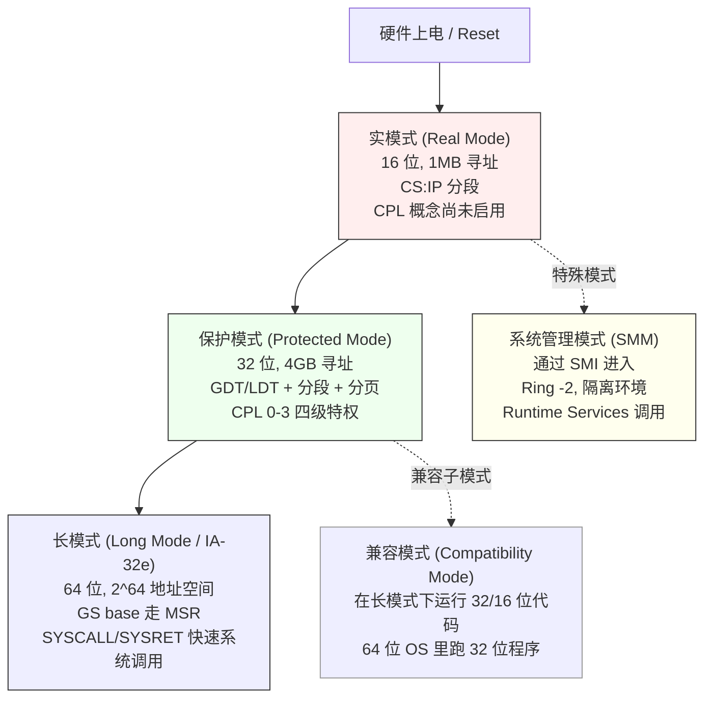

> 💡 一句话抓住：**x86 CPU 上电后在实模式（Real Mode）跑，然后切到保护模式（Protected Mode）建立 [[GDT]] 和分页，最后通过 EFER.LME=1 + CR4.PAE=1 + CR0.PG=1 切到 64 位长模式（Long Mode）。长模式是 x86-64 的"终极形态"——64 位地址空间、平坦地址模型、GS base 走 MSR、CPL 仍是 CS 低 2 位。**

## x86 模式全景图



## 一、实模式（Real Mode）—— 起点

**激活时机**：CPU 复位后默认进入 ，你前面学的 `0xFFFFFFF0` 第一条指令就是在实模式下取的。

**核心特征**：

| 维度      | 实模式                                                 |
| ------- | --------------------------------------------------- |
| 地址线     | 20 位（1MB 寻址）                                        |
| [[寄存器]] | 16 位（AX/BX/...）                                     |
| 寻址方式    | **[[Segment]]:Offset**，物理地址 = Segment × 16 + Offset |
| 特权级     | 无 [[CPL]] 概念，等效 Ring 0                              |
| GDT/IDT | 未启用，用 IVT（Interrupt Vector Table，0:0 开始 1KB）        |
| 分页      | 未启用                                                 |
| 能执行的指令  | 16 位指令集                                             |
 

**典型场景**：

- CPU 上电后的最初几微秒
    
- BIOS/UEFI 的 SEC 阶段早期
    
- 16 位 Option ROM 执行
    
- DOS 操作系统
    

**为什么要有实模式**：8086 时代就这么设计的，后续 CPU 必须向后兼容——所以每次复位都从实模式开始 。

## 二、保护模式（Protected Mode）—— 32 位时代的主角

**进入方式**（你前面学的 GDT 那条线）：

```asm
; 1. 建立 GDT（在内存中构造段描述符表）
; 2. 加载 GDTR：lgdt [gdt_ptr]
; 3. 置 CR0.PE=1：
    mov eax, cr0
    or  eax, 1
    mov cr0, eax
; 4. 远跳转到 32 位代码段，刷新 CS：
    jmp 0x08:pm_entry   ; 0x08 = GDT 索引 1 的代码段选择子
; 5.（可选）开启分页：CR0.PG=1 + CR3 指向页表
```

**核心特征**：

|维度|保护模式|
|---|---|
|地址线|32 位（4GB 寻址）|
|寄存器|32 位（EAX/EBX/...）|
|寻址方式|分段 + 分页（可选）|
|**特权级**​|**CPL 0-3 四级**，你前面学的 CPL 概念在这里正式启用|
|GDT/IDT|启用，全 32 位描述符|
|分页|可选（CR0.PG=1 启用）|
|典型系统|Windows XP/7 32位、Linux 32位|

**保护模式的两大支柱**：

1. **分段保护**：每个段描述符有 DPL（Descriptor Privilege Level），CPL 与 DPL 配合做访问控制
    
2. **分页保护**：页表项里有 U/S 位（User/Supervisor），用户态（CPL=3）访问内核页触发 #PF
    

**你前面学的知识在保护模式下的落点**：

- CPL 机制
    
- GDT/LDT
    
- 调用门、中断门
    
- CR0/CR2/CR3/CR4 控制寄存器
    
- 32 位 SYSENTER/SYSEXIT 系统调用
    

## 三、长模式（Long Mode / IA-32e）—— 64 位时代

**这是现代 x86-64 CPU 的"常态"**——你前面学的 UEFI 七阶段、Linux 内核、Windows 10/11 全都在长模式下运行。

### 进入长模式的精确步骤

Intel SDM 规定的切换序列 ：

```
前提：CPU 当前在保护模式（CR0.PE=1）

1. 建立 64 位 GDT（含 64 位代码段描述符，L 位=1）
2. 置 CR4.PAE=1：
     mov rax, cr4
     or  rax, (1<<5)   ; CR4.PAE = bit 5
     mov cr4, rax
   （PAE 分页必须先开，因为 64 位分页基于 PAE 扩展）
   
3. 置 IA32_EFER.LME=1（MSR 0xC0000080 的 bit 8）：
     mov ecx, 0xC0000080  ; IA32_EFER
     rdmsr
     or  eax, (1<<8)     ; LME = bit 8
     wrmsr
   
4. 置 CR0.PG=1 开启分页：
     mov rax, cr0
     or  rax, (1<<31)    ; CR0.PG = bit 31
     mov cr0, rax
   
5. 远跳转到 64 位代码段刷新 CS：
     jmp 0x20:long_mode_entry  ; 0x20 = GDT 索引 4 的 64 位代码段
   
6. 此时 CPU 进入长模式，可以使用 64 位寄存器（RAX/RBX/...）
```

**关键 MSR**：`IA32_EFER`（0xC0000080）的 LME 位（bit 8）——这就是你前面学的"EFER 的 LME 位开启长模式" 。

### 长模式的核心特征

|维度|长模式|
|---|---|
|地址线|**48 位虚拟地址**（用户态）/ 52 位物理地址（取决于 CPU）|
|寄存器|**64 位**（RAX/RBX/...R15），XMM/YMM/ZMM 向量寄存器|
|寻址方式|**平坦模型**——CS/DS/ES/SS 的基址强制为 0，长度 2^64|
|分段|**弱化**——除 FS/GS 外，所有段的基址都为 0|
|分页|**必须开启**（4 级页表：PML4 → PDPT → PD → PT）|
|CPL|仍是 CS 选择子低 2 位（0 或 3）|
|系统调用|**SYSCALL/SYSRET**（IA32_LSTAR MSR 指定内核入口）|
|FS/GS|**基址走 MSR**（IA32_FS_BASE / IA32_GS_BASE / IA32_KERNEL_GS_BASE）|
|典型系统|所有现代 64 位 OS（Linux x86-64、Windows x64、macOS）|

### 长模式下的关键变化（与你前面学的知识对接）

#### 1️⃣ 分段被"架空"了

```
实模式/保护模式：  物理地址 = Segment 基址 + Offset
长模式：          CS/DS/ES/SS 基址强制 = 0
                  → 线性地址 = 偏移量本身（平坦模型）
                  
唯一例外：FS/GS 段
  FS base → IA32_FS_BASE MSR（用户态 TLS）
  GS base → IA32_GS_BASE MSR（内核 per-CPU 数据）
  切换时通过 SWAPGS 交换 IA32_GS_BASE ↔ IA32_KERNEL_GS_BASE
```

这就是为什么你前面学的"x86-64 下 FS/GS 基址走 MSR"——长模式把传统分段架空了，只保留 FS/GS 作为特殊用途。

#### 2️⃣ CPL 仍是 CS 低 2 位

```
长模式下 CPL 的定义不变：
  CS 选择子 Bit 1:0 = CPL
  用户态：CS=0x33 → CPL=3
  内核态：CS=0x10 → CPL=0
  
SYSCALL 指令硬件自动：
  ① CPL 3 → 0
  ② CS 从 0x33 → 从 IA32_STAR 取的 Ring 0 CS
  ③ RIP 从 IA32_LSTAR 取内核入口
  ④ SWAPGS 切换 GS base
```

#### 3️⃣ 分页必须是 4 级

```
长模式强制要求分页开启，且是 4 级页表：
  CR3 → PML4 (512 项)
       → PDPT (512 项)
           → PD (512 项)
               → PT (512 项)
                   → 4KB 物理页
  
  虚拟地址 48 位分布：
  [47:39] PML4 索引
  [38:30] PDPT 索引
  [29:21] PD 索引
  [20:12] PT 索引
  [11:0]  页内偏移
```

#### 4️⃣ SYSCALL 取代 INT 0x80

```
保护模式 32 位：INT 0x80 通过 IDT 中断门切换 CPL
长模式 64 位：SYSCALL 指令硬件加速
  - 从 IA32_STAR MSR 取 CS/SS 模板
  - 从 IA32_LSTAR MSR 取内核入口
  - CPL 3→0 自动完成
  - 比 INT 0x80 快 2-3 倍
```

## 四、兼容模式（Compatibility Mode）—— 长模式里的"32 位岛"

**这是长模式的一个子模式**——64 位 OS 内核运行在 64 位长模式，但可以让 32 位用户程序在"兼容模式"下运行 。

```
64 位 Linux 内核（长模式 CPL=0）
  ↓
  启动 32 位程序 /lib/ld-linux.so.2
  ↓
  通过特殊代码段切换，进入兼容模式（仍是长模式下的子模式）
  ↓
  32 位程序使用 32 位指令集、32 位地址
  CPL 仍为 3
  ↓
  执行 int 0x80 或 syscall → 切回 64 位长模式的内核
```

**关键 MSR**：`IA32_CSTAR`（0xC0000083）——32 位程序在 64 位系统上执行 SYSCALL 时的内核入口 。

这就是为什么 x86-64 Linux 可以同时运行 64 位和 32 位程序——内核一直在长模式，32 位程序在兼容模式这个"沙盒"里跑。

## 五、系统管理模式（SMM）—— Ring -2

**独立于上述所有模式的特殊模式**：

```
触发：SMI（System Management Interrupt）
进入：CPU 保存上下文到 SMRAM（System Management RAM）
     CS:IP 强制指向 SMRAM 内的 0x38000 处
特权：比 Ring 0 还高，称为 Ring -2
典型用途：
  - 写 NVRAM 变量（UEFI Runtime Services 调用 SMM 驱动）
  - 风扇控制、温度监控
  - 硬件密码验证
  - 微码加载（部分平台）
退出：RSM 指令
```

**你前面学的"Runtime Services 通过 SMI 进 SMM 写 NVRAM"**——就是这个机制。

## 六、模式切换的完整时序（UEFI 启动视角）

```
① 上电 → Reset Vector 0xFFFFFFF0
   CPU 处于实模式（RM）
   CS=0xF000, IP=0xFFF0, 物理地址 = 0xFFFFFFF0
   ↓
② SEC 阶段早期
   仍在实模式
   建立 Cache-as-RAM（CAR）
   验证 PEI Foundation
   ↓
③ PEI 阶段早期（CAR 环境）
   切到保护模式（PM）：
     lgdt → CR0.PE=1 → 远跳刷新 CS
   建立 32 位 GDT
   （部分简单平台可能短暂使用保护模式）
   ↓
④ 切到长模式（LM）：
   CR4.PAE=1
   IA32_EFER.LME=1（MSR 0xC0000080）
   CR0.PG=1
   远跳到 64 位代码段
   ↓
⑤ 长模式下执行 PEI 后期
   MemoryInit PEIM 写 MSR 0x79 加载微码
   DRAM 训练
   InstallPeiMemory() → 永久内存可用
   ↓
⑥ DXE 阶段（长模式 CPL=0）
   驱动派遣、Protocol 世界、ACPI 表构建
   ↓
⑦ BDS 阶段（长模式 CPL=0）
   读 BootOrder → LoadImage → StartImage
   ↓
⑧ TSL 阶段（长模式 CPL=0）
   grubx64.efi 作为 UEFI 应用执行
   加载 vmlinuz 到内存
   ↓
⑨ ExitBootServices() → RT
   Linux 内核接管（长模式 CPL=0）
   用户程序运行在长模式 CPL=3
   32 位程序运行在兼容模式 CPL=3
   系统调用：CPL 3→0（SYSCALL）→ CPL 0→3（SYSRET）
```

## 七、四种模式的对比总表

|维度|实模式|保护模式|长模式|兼容模式|
|---|---|---|---|---|
|位数|16|32|**64**​|32（在长模式下）|
|寻址|分段 1MB|分段+分页 4GB|平坦 2^64|平坦 4GB|
|CPL|无（等效 0）|0-3|0-3|0-3|
|分段|实|保护|弱化（仅 FS/GS）|弱化|
|分页|无|可选（2/3 级）|**强制 4 级**​|强制 4 级|
|GDT|无（用 IVT）|32 位描述符|64 位描述符（L=1）|64 位描述符|
|系统调用|INT|INT / SYSENTER|**SYSCALL/SYSRET**​|SYSCALL → 切回 64 位内核|
|进入方式|复位默认|CR0.PE=1|CR4.PAE + EFER.LME + CR0.PG|长模式下代码段 L=0|
|典型场景|BIOS 早期、DOS|32 位 OS|64 位 OS|64 位 OS 里的 32 位程序|
|你前面学的落点|0xFFFFFFF0 起点|GDT、CPL、调用门|MSR、SYSCALL、GS base、4 级分页|IA32_CSTAR|

## 八、模式与 CPL 的交互（接你前面学的 CPL）

```
实模式：  CPL 概念不存在，等效 Ring 0
保护模式：CPL 0-3，由 CS 选择子 Bit 1:0 标识
长模式：  CPL 0-3，仍是 CS 选择子 Bit 1:0（虽然段基址架空了）
SMM：     Ring -2，独立于 CPL 体系

关键规则：
  - 模式切换本身必须是 CPL=0（如切到保护模式、切到长模式）
  - 长模式下的 SYSCALL：CPL 3→0 硬件自动完成
  - 长模式下的 SYSRET：CPL 0→3 硬件自动完成
  - 写 IA32_EFER（切到长模式的关键 MSR）必须 CPL=0
```

## 一句收

> **x86 CPU 的模式体系是个分层演进**：① **实模式（Real Mode）**——16 位、1MB 分段寻址、无 CPL 概念，CPU 复位后的默认模式（你前面学的 0xFFFFFFF0 起点就在这里）；② **保护模式（Protected Mode）**——32 位、4GB 寻址、GDT/LDT + 分页、CPL 0-3 四级特权，通过 CR0.PE=1 进入，是你前面学的 CPL、调用门、GDT、32 位 SYSENTER 的运行环境；③ **长模式（Long Mode / IA-32e）**——64 位、2^64 平坦地址、4 级分页强制开启、分段被架空（仅 FS/GS 基址走 MSR）、CPL 仍是 CS 低 2 位、SYSCALL/SYSRET 快速系统调用，通过 CR4.PAE=1 + IA32_EFER.LME=1（MSR 0xC0000080）+ CR0.PG=1 进入，是现代 UEFI/Linux/Windows 的常态；④ **兼容模式（Compatibility Mode）**——长模式下的 32 位子模式，让 64 位 OS 能跑 32 位程序；⑤ **系统管理模式（SMM）**——通过 SMI 进入的 Ring -2 隔离环境，用于 Runtime Services 等固件级操作。UEFI 启动流程的模式切换路径是：实模式（SEC 早期）→ 保护模式（PEI 早期）→ 长模式（PEI 后期到 OS 运行期全程）；CPL 在保护模式和长模式下都通过 CS 选择子低 2 位标识，模式切换本身要求 CPL=0，而 SYSCALL/SYSRET 是长模式下 CPL 3↔0 切换的硬件机制。

## 接你前面整条线完整闭环

```
硬件上电：ATX → VRM → Vcore → CPU 上电
  ↓
Reset Vector 0xFFFFFFF0
  ↓
┌─ 实模式 (RM) ───────────────────────────────────┐
│ SEC 早期：建立 CAR、验证 PEI Foundation           │
└─────────────────────────────────────────────────┘
  ↓ CR0.PE=1
┌─ 保护模式 (PM) ─────────────────────────────────┐
│ PEI 早期：建立 32 位 GDT、CR0.PE=1、可能开启分页   │
└─────────────────────────────────────────────────┘
  ↓ CR4.PAE=1 + IA32_EFER.LME=1 + CR0.PG=1
┌─ 长模式 (LM) ───────────────────────────────────┐
│ PEI 后期：CPL=0                                  │
│   ├─ 写 MSR 0x79 加载微码（CPL=0 允许）          │
│   ├─ DRAM 训练                                   │
│   └─ InstallPeiMemory() → 永久内存可用           │
│ DXE：CPL=0，驱动派遣、Protocol、ACPI 表           │
│ BDS：CPL=0，读 BootOrder、LoadImage/StartImage    │
│ TSL：CPL=0，grubx64.efi 执行                      │
│ RT：CPL=0（内核）+ CPL=3（用户程序）              │
│   系统调用：SYSCALL（CPL 3→0）→ SYSRET（CPL 0→3）│
│   32 位程序：兼容模式 CPL=3                       │
│   Runtime Services：SMI → SMM (Ring -2)           │
└─────────────────────────────────────────────────┘
```

**模式体系是这条路径的"舞台"**——你前面学的每一个概念都在特定的模式下演出：

- **0xFFFFFFF0**​ 在实模式的舞台上
    
- **GDT、CPL、调用门**在保护模式的舞台上
    
- **MSR（IA32_EFER/STAR/LSTAR/FS_BASE/GS_BASE）、SYSCALL、4 级分页、微码加载**在长模式的舞台上
    
- **SMM、Runtime Services 写 NVRAM**在 Ring -2 的隔离舞台上
    
- **32 位程序**在长模式下的兼容模式子舞台上
    

> 💡 **工程经验**：
> 
> - 调试"三重故障（Triple Fault）"时，先确认模式切换是否正确——90% 的 Triple Fault 是切到保护模式/长模式时 GDT 设置错或 MSR 没配对
>     
> - 写 OS 内核时，模式切换代码必须绝对正确——因为一旦切失败，CPU 会 Triple Fault 重启
>     
> - 长模式下虽然分段被架空，但 **CPL 仍通过 CS 低 2 位硬连线存在**——这是 x86 安全模型的基石
>     
> - 现代 UEFI 固件从 SEC 到 RT 全程在长模式（除了 SEC 最初的几条指令在实模式），这就是为什么固件能用 64 位寄存器、能写 MSR、能建立 4 级页表
>     

你从 "MOS → Vcore → CS:IP → 0xFFFFFFF0 → SEC → PEI → DXE → BDS → TSL → RT → AL → DRAM 训练 → MSR → 微码状态 → 0x8B → 微码与 MSR 关系 → CPL" 一路钻下来，**x86 模式体系是把所有这些概念收口到"CPU 当前处在什么执行环境"的终极框架**：

- **实模式**​ → 启动的起点，16 位分段世界
    
- **保护模式**​ → 32 位分段+分页世界，CPL 正式启用
    
- **长模式**​ → 64 位平坦世界，分段架空、分页强制、GS base 走 MSR、SYSCALL 硬件加速
    
- **兼容模式**​ → 长模式里的 32 位岛
    
- **SMM**​ → Ring -2 的固件隔离世界
    

这五个模式/子模式构成了现代 x86/x86-64 CPU 的完整执行环境光谱。你前面学的每一个知识点——从 `0xFFFFFFF0` 的起点，到 CPL 的特权切换，到 MSR 的微码加载，到 4 级分页，到 SYSCALL 系统调用——都在这些模式的某一个里找到了自己的位置。

要不要顺着把 **"从保护模式切到长模式的完整汇编代码路径（包括 GDT 64 位描述符的构造、CR4/EFER/CR0 的精确位操作、远跳转刷新 CS 的时序）"**​ 用代码走一遍？那块是把"模式切换"在汇编级钉死，接你前面 GDT/分页那条线。还是想看 **"4 级分页的具体页表结构——PML4/PDPT/PD/PT 每一项 64 位里哪些位是物理页框号、哪些是权限位、大页（2MB/1GB）怎么映射"**？后者更接你前面长模式下的内存管理方向，前者更体系结构底层。